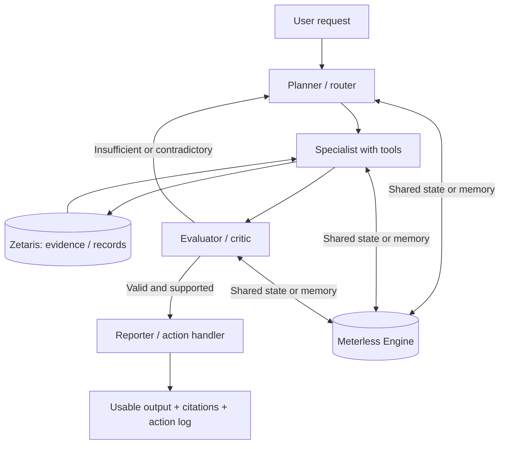
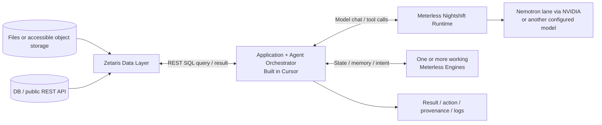
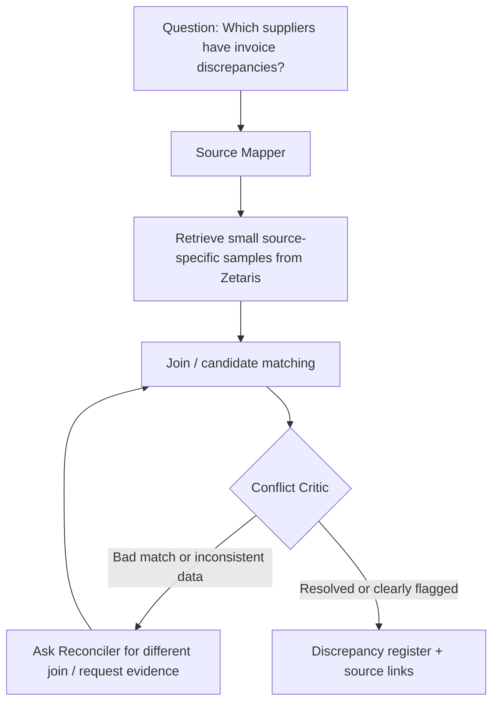
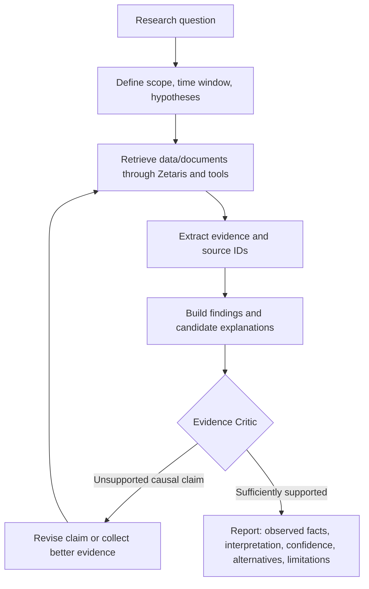
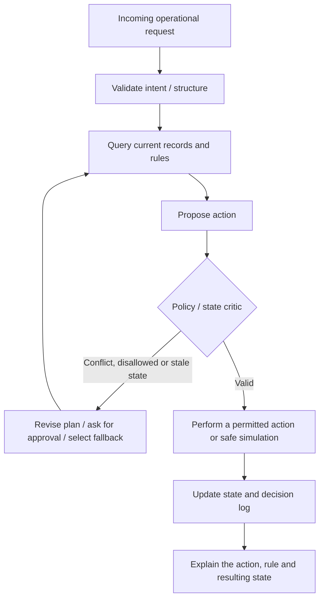

# Open Agent Hackathon 2026 — Complete Participant and Build Handbook

**Prepared:** 22 October 2026 (Singapore time)  
**Purpose:** A practical, source-grounded reference for understanding the competition, obtaining usable data, selecting a track, designing and building an agent system, and submitting a reproducible project.  
**Basis:** The participant's *How to APPROACH Solutioning For Your Track*, *Participant Journey Map*, *Hackathon Overview*, and 30-page *Participant Setup Guide* (last updated 21 October 2026), cross-checked against the official event page and Zetaris's public Getting Started repository.

> **Scope and authority:** This is a planning and implementation guide, **not** an official replacement for the rules. The exact, individual challenge pages available inside HackOS may contain additional requirements not included in the four shared documents. Read those pages before committing to a final use case. Where public sources disagree with the participant documents, the discrepancy is documented in [Section 2.4](#24-conflicts-or-uncertainties-to-check-in-hackos).

---

## Table of contents

1. [Executive summary](#1-executive-summary)
2. [Competition details, dates, and rules](#2-competition-details-dates-and-rules)
3. [What the organisers mean by a working AI agent](#3-what-the-organisers-mean-by-a-working-ai-agent)
4. [The three tracks at a glance](#4-the-three-tracks-at-a-glance)
5. [Data collection: what you need, where to find it, and how to prepare it](#5-data-collection-what-you-need-where-to-find-it-and-how-to-prepare-it)
6. [What datasets and connectors are available through Zetaris](#6-what-datasets-and-connectors-are-available-through-zetaris)
7. [Mandatory technology stack: Data, Build, and Power](#7-mandatory-technology-stack-data-build-and-power)
8. [Track 1: Solving Fragmented Intelligence](#8-track-1-solving-fragmented-intelligence)
9. [Track 2: The Agent That Can Explain Why](#9-track-2-the-agent-that-can-explain-why)
10. [Track 3: Reasoning Architecture](#10-track-3-reasoning-architecture)
11. [Bonus: Wildcard (Tinkerer)](#11-bonus-wildcard-tinkerer)
12. [Choosing a track and a feasible problem](#12-choosing-a-track-and-a-feasible-problem)
13. [Recommended project blueprints](#13-recommended-project-blueprints)
14. [Architecture, tests, and reliability standards](#14-architecture-tests-and-reliability-standards)
15. [Build schedule for 22–27 October](#15-build-schedule-for-2227-october)
16. [Judging and how to demonstrate each criterion](#16-judging-and-how-to-demonstrate-each-criterion)
17. [Submission materials and repository template](#17-submission-materials-and-repository-template)
18. [Checklists](#18-checklists)
19. [Frequently asked questions and pitfalls](#19-frequently-asked-questions-and-pitfalls)
20. [Source register and links](#20-source-register-and-links)

---

## 1. Executive summary

### 1.1 The most important conclusions

- **You do not need to train a foundation model or an LLM.** You can use an existing model accessed through the required runtime. What you must build is the *agent system*: its tools, data access, roles, control flow, verification, and useful outputs.
- **You normally source, create, or select your own use-case data.** You can use public APIs, open datasets, small synthetic datasets, accessible operational samples, or selected Zetaris starter recipes. The organisers' documentation does not promise a universal pre-labelled dataset for every track.
- **Zetaris is compulsory.** It is chiefly a data-access/query layer; its public repository offers sample tables, data-connection recipes, examples, and source-status documentation. It is not a dataset marketplace.
- **Cursor is compulsory as the development environment.** The newer Setup Guide additionally requires **at least one Meterless Engine integrated into a working feature**, not merely included as a dependency.
- **Meterless Nightshift must function as a primary AI runtime/provider.** NVIDIA Nemotron can be used as a model through the Nightshift provider configuration; its useful integration is especially relevant to the NVIDIA award.
- **Judges reward working, verifiable agent behaviour**, especially dynamic delegation, feedback, critique, revisions, shared state, branching, recovery, traceable evidence, and a tangible output.
- **Small, well-tested, repeatable projects beat unbounded ambitious ones.** Build a working narrow case first and then add capability.

### 1.2 One-page track comparison

| Dimension | Track 1 — Fragmented Intelligence | Track 2 — Explain Why | Track 3 — Reasoning Architecture |
|---|---|---|---|
| Core question | Can the agent find and reconcile information across disconnected sources? | Can the agent investigate a bounded question and substantiate its conclusion? | Can the agent use rules, data, knowledge and memory to make and carry out reliable decisions? |
| Core technical problem | Integration, entity matching, conflicting facts, provenance | Retrieval, evidence quality, synthesis, uncertainty, factual critique | State, policies, planning, decision control, memory, action verification |
| Ideal initial data | 3–4 small related sources | A bounded corpus or small number of complementary sources | Operational records, policy/rule set, events, prior decisions |
| Main agent behaviour | Source discovery → reconciliation → conflict resolution → sourced answer | Investigate → gather evidence → evaluate claims → re-research → cited report | Intake → rules/state check → plan/action → critic → memory update |
| Good Meterless Engine fit | World Model; Scout Intent | Markovian; H-MEM | World Model; H-MEM; Scout Intent |
| Essential demo moment | Two sources disagree; the agent detects and handles it | A critic rejects an unsupported claim and triggers better research | The agent revises or blocks a decision because of policy, memory, or changed state |
| Main risk | Incompatible identifiers or brittle connectors | Unsupported causal explanations / fabricated citations | Unreliable autonomous actions / opaque memory and policy conflicts |

**Interpretation:** These columns are implementation recommendations based on the provided track descriptions, **not additional official track-specific rules**.

---

## 2. Competition details, dates, and rules

### 2.1 Basic details

| Item | Detail |
|---|---|
| Event | Open Agent Hackathon 2026 |
| Organiser/platform | GenAI.Works; HackOS for teams, announcements, mentoring, resources, submissions |
| Format | Fully online, worldwide |
| Eligibility | Anyone aged 16 or older at the start of the build window |
| Participation cost | Free registration |
| Team size | 1–5 builders; solo entries compete in the same pool as teams |
| Number of primary tracks | Choose exactly one of the three, or the bonus Wildcard track |
| Sponsor stack | Zetaris, Cursor (with Space XAI), Meterless; NVIDIA where it contributes |
| Frameworks and models | Open choice, subject to mandatory sponsor integration |
| Submission site | HackOS |
| Prize pool | Up to US$20,000 in cash and in-kind prizes; see current public rules for the distribution |
| Official event | <https://hackathon.genai.works/event/open-agent-hackathon-2026> |

### 2.2 Key dates in UTC and Singapore time

| Milestone | UTC | Singapore (SGT, UTC+8) |
|---|---|---|
| Build window opens | Thu **22 Oct, 00:00** | Thu **22 Oct, 08:00** |
| Registration closes — public event page | Thu **22 Oct, 23:59** | Fri **23 Oct, 07:59** |
| Submission deadline | Tue **27 Oct, 23:45** | Wed **28 Oct, 07:45** |
| Results announced | Fri **6 Nov, 16:00** | Sat **7 Nov, 00:00** |

**Important:** The documents call the event a **144-hour build window**, running from 22 October 00:00 UTC through 27 October 23:45 UTC. Treat the 23:45 UTC submission cutoff as hard and submit well ahead of it.

### 2.3 Participation and work restrictions

1. Each person has **one participant account**. Duplicate accounts can disqualify a team.
2. Each participant belongs to one team; team composition is stated to lock when the first submission is created.
3. A team may change its chosen primary track before the submission cutoff.
4. You can use open-source libraries and existing frameworks, but **pre-existing product-specific code/components must be declared**. The organisers assess new work performed during the event; this is particularly important for Wildcard entries.
5. Generated code is allowed, but you are responsible for its quality, legality, correctness, and security.
6. Keep access tokens, provider keys, passwords, and other credentials out of GitHub, screenshots, logs, slide decks, and `.env.example`.
7. Your project must be functional, run reproducibly, and show meaningful agent actions—not only mocked interface screens or a slide deck.
8. The published participant materials recommend a short, bounded, automated run and a small dataset rather than downloading and training over massive corpora during judging.

### 2.4 Conflicts or uncertainties to check in HackOS

The documents and currently published event page are not perfectly aligned:

- **Registration cutoff:** Participant Journey Map / Hackathon Overview list **22 Oct 23:45 UTC**, while the **live official event page lists 22 Oct 23:59 UTC**. If not already registered, use the earlier time for safety and confirm inside HackOS.
- **Judging start:** The participant documents describe judging from **28 October**, while the current event page lists **27 October 00:00 UTC**. This does **not** affect your submission cutoff.
- **Prize allocations:** The participant Overview's per-track cash amounts differ from the current event page. Consult the event page and Official Rules when evaluating prizes; do not rely on an old slide or overview table.
- **Sponsor-engine specificity:** The earlier overview says Zetaris + Meterless + Cursor; the **21 October Setup Guide is more specific**: one working Meterless Engine **and** Meterless Nightshift integration are expected. Plan to satisfy the stricter setup-guide requirements.
- **Detailed track pages:** The four files give broad challenge statements and examples. Full individual challenge statements, outputs, and track-specific caveats may exist only inside HackOS and should be checked separately.

---

## 3. What the organisers mean by a working AI agent

### 3.1 Chatbot vs workflow vs genuine agent system

| Pattern | Example | Why it matters |
|---|---|---|
| Chatbot | A single prompt produces a generic answer | Not enough to demonstrate agentic work |
| Rigid pipeline | Agent A summarizes, B rewrites, C formats | Still weak if there is no adaptation, verification, or feedback |
| Agent system | Planner selects tools, researcher queries evidence, critic checks it, researcher retries, action agent produces a verifiable outcome | Demonstrates meaningful interdependence and recovery |

**Do not expose hidden model reasoning as your audit trail.** Show **observable evidence of behaviour**: the plan or task summary, tool calls, data source references, relevant results, rule outcomes, confidence/evidence checks, revision decisions, and final action/result. Such traces are testable and are more useful than a model's unsupported claim that it “reasoned carefully.”

### 3.2 The minimum architecture worth implementing



A strong small project can have **2–4 meaningful roles**, one narrow decision, clear output, and a real critique/revision loop. The guide recommends 3 or more collaboration behaviours such as delegation, critique, branching, memory, retry, fallback, and evidence tracing. There is no advantage in creating five superficial agents if three well-designed agents coordinate effectively.

### 3.3 Examples of verifiable agent outputs

- A reconciled table with rows linked to original sources, discrepancies, and unresolved conflicts.
- A research report with clickable citations, distinction between evidence and interpretation, and rejected hypotheses.
- A priority queue or schedule with applied rules, reasons, a reversible simulated action, and a record of changed state.
- A work item, email draft, incident report, or other artifact **actually produced**, not merely described as something that could be done.

---

## 4. The three tracks at a glance

### Track 1 — Solving Fragmented Intelligence

**Official goal:** Demonstrate a clever ability to discover and work across fragmented data sources.

In practical terms, design a system where useful answers are distributed across files, a database, REST endpoints, or separate business systems. The agent must map sources, resolve identifiers and conflicts, and present one explainable result.

### Track 2 — The Agent That Can Explain Why

**Official goal:** Build agents that investigate complex questions across multiple sources, connect findings, and produce evidence-backed answers or recommendations.

In practical terms, build a bounded research/investigation workflow. It should identify relevant facts, test competing explanations, critique the evidence and explain uncertainty. A plausible story is **not** proof of causality.

### Track 3 — Reasoning Architecture

**Official goal:** Demonstrate a novel ability to turn data, knowledge, memory, and reasoning into reliable decisions and actions.

In practical terms, build a stateful decision system that consults records and policies, plans an action, checks constraints and updates memory/records. Success means **consistent, inspectable decisions**, not just longer model responses.

### Bonus — Wildcard (Tinkerer)

Bring an existing prototype, project or concept; extend it meaningfully using the required technology. The **new feature developed during the window** is what you need to demonstrate and distinguish from pre-existing work.

---

## 5. Data collection: what you need, where to find it, and how to prepare it

### 5.1 Do you have to train the AI on a dataset?

**No.** There are two separate concepts:

- **Model training/fine-tuning:** changing neural-network parameters using training examples. This is **not required** by the provided hackathon guidance and is usually inappropriate for a six-day sprint.
- **Agent grounding:** giving an already capable model access to useful facts, documents, state, SQL queries, tools, policies, and memory at runtime. This is what these tracks primarily demand.

Your project can call a hosted model, retrieve rows from Zetaris, pass a compact evidence summary to the model, validate the proposed output, and return the result—all without doing model training.

### 5.2 Accepted data strategies described by the organisers

| Strategy | Implementation | Advantages | Risks / guardrails |
|---|---|---|---|
| Small static sample | Put permitted, lightweight CSV/JSON/text files in `data/sample/` | Reproducible; works for judges | Do not include personal, confidential or excessively large raw data |
| Scripted download | Provide `scripts/download_data.py` or equivalent | Repeatable open-data ingestion | API/connection failures; licences; rate limits |
| Live public API | Register an endpoint in Zetaris or call an API from controlled server-side tools | Fresh data | Authentication, rate limits, network access and uptime |
| Generated synthetic data | Generate a reproducible collection of fictitious records and policies | Ideal for operational tests and conflicts | Label synthetic cases clearly; avoid claiming they are real cases |
| Mixed approach | Live query where possible, checked cached sample as fallback | Good balance of authenticity/reliability | Show in the demo when live vs sample data was used |

The *APPROACH* guide explicitly recommends `SAMPLE_MODE=true` as a fallback for public API failures, short query paths, and cached demonstration cases.

### 5.3 Suggested dataset size by track

These are **working-size recommendations, not official minimums or caps**:

| Track | Small baseline that can tell a convincing story |
|---|---|
| 1 | 3 small sources, e.g. 20–100 records each, plus 3–5 deliberate cross-source inconsistencies |
| 2 | 5–10 documents and/or 1–2 structured datasets relevant to one question; 3–5 tested research questions |
| 3 | 20–50 synthetic operational records, one short policy/rule set, and several remembered decisions/changes |
| Wildcard | Curated sample from an existing project plus deterministic examples proving the *new* capability |

A larger dataset is useful only if it improves the problem being solved. Avoid huge downloads, GPU training, and unbounded processing in the demonstration.

### 5.4 Recommended public data discovery websites

These are **potential external sources**, not necessarily pre-integrated Zetaris connectors:

| Source | Useful categories | URL | Check before using |
|---|---|---|---|
| Singapore Government open data | HDB, transport, business, population, environment | <https://data.gov.sg/> | Endpoint access, dataset licensing, historical coverage |
| World Bank Open Data | GDP, poverty, development, education | <https://data.worldbank.org/> | Date range, definitions, API restrictions |
| US SEC EDGAR | Company filings, financial fundamentals | <https://www.sec.gov/search-filings/edgar-search-assistance/accessing-edgar-data> | User-Agent and request limits; filings' reuse conditions |
| Open Food Facts | Product/nutrition metadata | <https://world.openfoodfacts.org/> | ODbL attribution/share-alike obligations |
| Kaggle | Public datasets across many domains | <https://www.kaggle.com/datasets> | Dataset-specific licence; provenance; privacy |
| Hugging Face Datasets | Research/text/tabular datasets | <https://huggingface.co/datasets> | Licence, original source, suitability for redistribution |
| NOAA | Weather/climate observations | <https://www.ncei.noaa.gov/> | Coverage, location, units, missing values |
| Eurostat | European economic and social indicators | <https://ec.europa.eu/eurostat> | Geographical coverage, frequencies and data definitions |
| NASA APIs | Astronomical records | <https://api.nasa.gov/> | Rate limits and API availability |

### 5.5 A rigorous data-acquisition workflow

1. **Specify the decision.** Write: “The agent helps [person] decide [X] by using [sources] and producing [artifact/action].”
2. **List the exact facts needed.** For example: `supplier_id`, `contract_price`, `invoice_price`, `payment_status`, `report_date`.
3. **Select sources for each fact.** Aim for at least one trustworthy canonical source per key claim; document any conflicting or overlapping sources.
4. **Check access and legal reuse.** Confirm the licence, API key requirements, rate limits, sensitive content and access from your deployment/test environment.
5. **Verify grain and join keys.** Is a row a company, transaction, supplier, day, document, station, or event? Do not join on fuzzy display names without safeguards.
6. **Sample and normalize.** Convert dates/time zones, units, IDs, encoding, category mappings and missing values; retain source IDs.
7. **Register sources with Zetaris.** Use an existing REST/filestore recipe or documented connector; keep credentials server-side.
8. **Build ground truth/test cases.** Annotate known matches/conflicts, verified facts, valid decisions or policy violations.
9. **Create a fallback.** Save a small permitted snapshot and expose `SAMPLE_MODE=true` when the live provider is unavailable.
10. **Document limitations.** Make clear what is sampled, synthetic, stale, incomplete or unavailable.

### 5.6 Suggested data provenance file

Put a `data/README.md` in your repository, using a record like:

```markdown
## Source: supplier_contracts_sample.csv
- Origin: Synthetic data generated for this hackathon
- Retrieval/generation date: 2026-10-22
- Licence and redistribution: Synthetic, original to this project
- Grain: One row per supplier contract
- Key fields: supplier_id, contract_id, unit_price, effective_date
- Rows included: 30
- Why sampled: Deterministic reconciliation demo
- Regeneration: python scripts/generate_sample.py --seed 2026
- Known limitations: Simplifies currencies, contract amendments and tax
- Zetaris access: Registered from an accessible file store; not a laptop-only path
```

For real sources, replace the origin with the primary source URL, dataset version, attribution, relevant licence, and original retrieval procedure. Do not assert that using a public website automatically makes every dataset free to redistribute.

### 5.7 Data safety

- Use fictional identities or properly anonymised sample records for tickets, accounts, patients or employees.
- Do **not** upload real bank statements, patient records, API tokens, emails or private company documents to public GitHub just to make a demo.
- Add `.env`, caches, local downloads, credentials and raw dumps to `.gitignore`.
- Pin an extract/snapshot date where data changes over time; report missing or contradictory facts openly.
- Query only the minimum fields needed; avoid full-table scans in a demo.

---
## 6. What datasets and connectors are available through Zetaris

**Key distinction:** Zetaris is a **query and semantic/data integration platform**. The [official Getting Started repository](https://github.com/zetaris/getting-started) contains a small number of supplied example tables and **recipes** showing how to make external datasets queryable. A verified recipe is evidence that Zetaris successfully registered and queried that source in a recorded test—not a guarantee that your particular local installation or the third-party endpoint will work without setup.

The following inventory was checked against the repository's [onboarding manifest](https://github.com/zetaris/getting-started/blob/main/open_data/manifest.json), [REST catalog](https://github.com/zetaris/getting-started/blob/main/open_data/rest_apis/rest-api-sources.md), [file catalog](https://github.com/zetaris/getting-started/blob/main/open_data/parquet_csv/parquet-csv-data-sources.md), and [recipe-readiness guide](https://github.com/zetaris/getting-started/blob/main/docs/guides/recipe-readiness.md) on 22 October 2026.

### 6.1 The easiest supplied sample tables

| Dataset / source | What it represents | How to inspect | Caveat |
|---|---|---|---|
| **NY Taxi** | Taxi-related reference/operational data, including `taxi_zones` | `SHOW LIGHTNING TABLES NY_TAXI;` | Visibility depends on your instance and query permissions |
| **TPC-DS** (`TPCDS_DB`) | Retail benchmark-style tables, including a `reason` table | `SHOW LIGHTNING TABLES TPCDS_DB;` | Supplied sample availability can vary by installation |
| **PokéAPI starter** | Nested JSON of Pokémon abilities, types and other game information | Follow the official PokéAPI SQL onboarding recipe | Not installed as your business dataset automatically; create the REST source |
| **Optional platform seed data** | The local install guide mentions the `ZETARIS_SEED_TPCH` setting | Check the actual databases visible in SQL Editor | Do not assume TPCH, TPC-DS and Taxi are identical or always seeded together |

The Zetaris [first SQL commands](https://github.com/zetaris/getting-started/blob/main/docs/connections/lightning-recipe-reference.md) show this discovery sequence:

```sql
SELECT 1 AS one;
SHOW LIGHTNING DATABASES;
SHOW LIGHTNING TABLES NY_TAXI;
SHOW LIGHTNING TABLES TPCDS_DB;
DESCRIBE DATASOURCE TABLE NY_TAXI.taxi_zones;
SELECT * FROM NY_TAXI.taxi_zones LIMIT 5;
SELECT * FROM TPCDS_DB.reason LIMIT 5;
```

Run **each complete SQL statement separately**, and inspect the tables your login actually exposes. If the tables are absent, do not assume they exist in a different namespace: consult the installation notes or HackOS sponsor support.

### 6.2 Verified REST/API onboarding recipes

| Recipe | What you can query | Good potential project use | Important access/licence issue |
|---|---|---|---|
| **SEC EDGAR company facts** (`edgar_facts`) | XBRL revenue facts for a small set of companies | Company-financial investigation; comparing filings | Declared `User-Agent`, rate limits; reuse of company-authored filing contents is not automatically open-licensed |
| **SEC company profiles** (`edgar_profiles`) | Company profiles enriched by sector classification | Join company facts to an industry hierarchy | Depends on EDGAR facts and `company_dns` |
| **US SIC codes** (`company_dns`) | Industry-code hierarchy | Source reconciliation / industry classification | Identification and rate-limit etiquette |
| **EU NACE classification** (`company_dns_eu_nace`) | EU industry classification categories | Multinational sector classification, terminology mapping | Attribution; documented CC BY 4.0 |
| **Japan industry classifications** (`company_dns_japan`) | Japanese industry codes | Cross-country classification examples | Attribution; documented CC BY 4.0 |
| **PokéAPI** (`pokeapi`) | Pokémon abilities, stats and related nested JSON | First working REST test; schema/retrieval demo | Fair-use and intellectual-property constraints; not a strong societal-impact topic by itself |
| **Open Food Facts live API** (`open_food_facts`) | Product/nutrition data for selected items | Product information reconciliation | ODbL conditions, User-Agent and rate limits |
| **NASA NeoWs** (`nasa_neows`) | Near-Earth object listings | Bounded scientific data agent | NASA API quota; starter uses `DEMO_KEY` quota |
| **Eurostat** (`eurostat`) | European statistics through a JSON-stat endpoint | Evidence-backed policy/economic research | Indicator definitions, country/time coverage |
| **Statistics Canada WDS** (`statcan_wds`) | Statistics Canada changed-cube listing | Data discovery/change monitoring | API rate limits and interpreting the endpoint's scope |
| **Australian Bureau of Statistics** (`abs_data_api`) | CPI through the ABS SDMX-JSON endpoint | Economic trend research and comparison | Data dimensions, period/unit matching |

**Two especially promising combinations:**

1. **EDGAR revenue facts + company profiles + US SIC**: meaningful relational data for Track 1 or Track 2. The repo includes a tested USL (Unified Semantic Layer) example that connects sector classifications and company records.
2. **A statistical REST recipe + a small verified document set**: useful for Track 2, provided your final answer attributes each numerical fact to its source and does not overclaim causal explanation.

### 6.3 Verified file-store/Parquet/CSV recipes

| Recipe | Data type | Example | Limitations |
|---|---|---|---|
| **NOAA GHCN-Daily** (`noaa_ghcn`) | Weather station observations, CSV, public S3 | Climate/weather data comparisons | The repo's example uses a bounded annual CSV; caching is needed for the demonstrated queries |
| **AWS Public Blockchain** (`aws_public_blockchain`) | Blockchain records, Parquet, public S3 | Transaction-pattern investigation / network data | Sample paths and dates change; redistribution/licence status must be checked |

The NOAA recipe is a much safer first file-source experiment than trying to connect a multi-gigabyte open-data archive. Check the specific object path, licensing and exact SQL in the recipe before running it. “Verified” refers to the repository's documented test, **not** a test carried out in your instance.

### 6.4 Tested semantic-layer examples

| Source ID | Function | Dependency |
|---|---|---|
| `sic_usl` | A semantic view over the SIC hierarchy | `company_dns` |
| `sic_edgar_usl` | A two-table relational model connecting SEC company profiles and industry classifications | `company_dns`, `edgar_profiles` (and their upstream dependencies) |

These are particularly relevant if you want to show **more than ordinary flat-file retrieval**. The judge can see a business-friendly joined view and how the agent uses it. Show the actual query, join keys, record count, data-quality results and any unmatched records.

### 6.5 Sources the Zetaris repository says are **known to fail**

| Source | Area | Documented issue/status | Suggested response |
|---|---|---|---|
| Singapore data.gov.sg PM2.5 API | Environment | Failed during source creation (HTTP 502 in recorded test) | Do not make it your only live dependency; build a permitted cached alternative |
| NASA DONKI solar-event/CME endpoint | Space weather | Recorded gateway/API failure | Use NeoWs or another working source instead |
| Catalyst Cooperative PUDL | Energy/utilities | Registration or query problems; repository notes a conflicting earlier test | Avoid as a critical-path Zetaris recipe until you personally verify it |
| Foursquare Open Source Places | Places/geospatial | Registration/query limitations | Use a small alternative dataset or different access path |
| Overture Maps | GeoParquet/maps | Bounded samples may work but caching/analytical queries can stall | Avoid a large live geospatial workload during judging |
| Ookla Speedtest open data | Telecom | Registration problem | Use prevalidated sample or different source |
| GBIF occurrences | Biodiversity | Query issues with registered source | Avoid relying on the recipe for your live demo |

**Important nuance:** The underlying datasets may still be publicly obtainable directly from their publishers. The table means **the corresponding Zetaris Getting Started recipes have documented failures**, not that those entire datasets are permanently unavailable.

The repository also lists **Singapore housing** and **Open Food Facts bulk files** as *download-fetcher-only* paths whose Zetaris table registrations have not been validated. They should not be described as ready-to-query native Zetaris datasets.

### 6.6 How to connect a dataset to Zetaris

**Path A — Supplied sample (fastest):** Inspect `SHOW LIGHTNING DATABASES`, query NY Taxi/TPC-DS if present, and build a read-only agent tool that runs limited SQL against known tables.

**Path B — REST API (good next step):** Clone the Getting Started repository, read its source catalog and select a verified recipe. The starter PokéAPI create recipe lives at:

```text
open_data/rest_apis/sql/non_rate_limited/02_pokeapi_create.sql
```

Follow the SQL order described in the Participant Setup Guide (page 10), creating the Lightning REST database/table/view and checking the sample query. The full statement definitions are in the source file; do not reconstruct them from an abbreviated screenshot.

**Path C — Public S3 file:** Follow the official file-store recipe (for example NOAA). Verify that Zetaris—not merely your laptop—can reach the object location, and use a bounded subset rather than a broad scan.

**Path D — Your own CSV/JSON:** Generate or obtain licensed data and put it in a supported, Zetaris-accessible storage or service. **A file existing solely on your laptop is not automatically readable by Zetaris.** Follow the official accessible storage and table-registration procedure; do not assume uploading a local file into your application creates a Zetaris table.

**Path E — Joined semantic view:** Register the underlying sources and create a USL or appropriate model/view to join them. Inspect join keys and unmatched rows.

### 6.7 Recommended repository commands for discovering recipes

```bash
# From the folder where you want the Zetaris helper repository:
git clone https://github.com/zetaris/getting-started.git
cd getting-started

# Review recipe IDs and their verification/dependency status:
python3 scripts/onboard.py --list
python3 scripts/onboard.py --check

# Example: plan a combined SIC + EDGAR semantic-layer onboarding:
python3 scripts/onboard.py plan sic_edgar_usl

# Preview changes; do NOT skip this step before running create scripts:
python3 scripts/onboard.py run sic_edgar_usl --dry-run
```

For these commands to contact your own instance, set up `.env.local` as described in [`scripts/HOWTO.md`](https://github.com/zetaris/getting-started/blob/main/scripts/HOWTO.md) and obtain your own Zetaris credentials. **Do not run a non-dry-run create/teardown command blindly**, and do not expect the examples to work on a machine that has not installed/configured Zetaris.

Useful source inventory paths:

- [Zetaris Getting Started — README](https://github.com/zetaris/getting-started)
- [Start Here](https://github.com/zetaris/getting-started/blob/main/START-HERE.md)
- [Recipe readiness](https://github.com/zetaris/getting-started/blob/main/docs/guides/recipe-readiness.md)
- [Machine-readable manifest](https://github.com/zetaris/getting-started/blob/main/open_data/manifest.json)
- [REST source catalog](https://github.com/zetaris/getting-started/blob/main/open_data/rest_apis/rest-api-sources.md)
- [Parquet/CSV source catalog](https://github.com/zetaris/getting-started/blob/main/open_data/parquet_csv/parquet-csv-data-sources.md)
- [SQL first steps](https://github.com/zetaris/getting-started/blob/main/docs/connections/lightning-recipe-reference.md)
- [Zetaris scripts HOWTO](https://github.com/zetaris/getting-started/blob/main/scripts/HOWTO.md)

---

## 7. Mandatory technology stack: Data, Build, and Power

The **Participant Setup Guide, pages 2–3, 12–20** gives a precise three-layer setup. The technologies must have a **real purpose in the working submission**, not just appear in the README.

### 7.1 Overall architecture



### 7.2 DATA — Zetaris (required)

**Role:** The governed/federated source of facts for the agent. Access files, REST data, and databases through a coherent SQL/query layer rather than embedding entire raw datasets in a prompt.

**Prerequisites described in the guide:**

| Item | Requirement / recommendation |
|---|---|
| Docker | Docker Desktop/Engine with Compose; v25+ recommended |
| Docker allocation | **8 GB RAM and 4 CPU cores** |
| Disk | At least **15 GB free** plus space for data |
| Physical computer | 16 GB RAM or more recommended for a smooth local setup |
| Apple Silicon | The guide says Intel-built images may require Rosetta in Docker and a slower first start |
| Windows | WSL 2 and Docker Desktop WSL integration |
| Alternative | Managed AWS cluster is documented, but AWS resources may incur charges |
| Setup artifact | Platform bundle and registry credentials from Zetaris Cloud's **Run locally** page |
| User login | Set admin email, strong password and organisation in the platform's private `.env` before first start |
| Local UI | `http://localhost:3000` |
| Local REST base | `http://localhost:8888/api/v1.0` |
| API reference | `http://localhost:8888/redoc/index.html` |

**Local-install milestone sequence:**

1. Obtain the licensed/authenticated Zetaris bundle from the official Zetaris Cloud portal.
2. Install and allocate Docker resources. Check `docker version` and `docker compose version`.
3. Unzip the platform bundle and enter its directory.
4. Log into the registry using your **own** Zetaris-provided credentials, then run `./preflight.sh`.
5. Set private admin fields in the platform `.env`, preserve supplied settings, and validate `docker compose config --quiet`.
6. Run `docker compose pull` and `docker compose up -d`.
7. Run `./verify.sh` and ensure all **9 checks** pass.
8. Sign into the web UI and execute `SELECT 1 AS one;`.
9. Verify one real dataset, then generate an app-facing Zetaris API key yourself.

The Setup Guide estimates the **first** Zetaris download/start at about 30–45 minutes, potentially longer depending on hardware/network. This is a setup estimate, not a guaranteed duration.

**Connecting your application:**

- Use `POST <ZETARIS_REST_URL>/sql-editor/sqls/run` according to the API specification served by **your** installation.
- Send a bearer API key, `X-Org-ID`, and a fresh UUID `X-Request-ID` as documented in the Setup Guide, page 11.
- Limit queries to known schemas and reasonable row counts; avoid exposing arbitrary write-capable SQL generated by an LLM without validation.
- Credentials stay server-side. The app should expose a **safe query tool**, not a raw secret-bearing connection in browser JavaScript.
- Cite rows, source IDs, query timestamps and source names in your final product output.

### 7.3 BUILD — Cursor (required)

**Role:** Use Cursor as the coding/development environment. The Setup Guide recommends its available Composer or Grok models for coding assistance (subject to your account/credits).

**Minimal Cursor test:**

1. Install Cursor and sign in.
2. Open your project folder.
3. Use an available coding model in Agent chat.
4. Ask the assistant to create and execute a simple Python `hello` file.
5. Confirm that Cursor created the file, ran it, and printed output.

**Distinguish development-time and runtime AI:** Cursor's coding model helps **write the program**. Your product's model calls must go through the configured product runtime; do not assume Cursor's paid coding credit funds your deployed application's queries.

### 7.4 BUILD — At least one working Meterless Engine (required in the newer guide)

| Engine | What it adds | Especially suitable for | Demonstrable test |
|---|---|---|---|
| **H-MEM** | Persist and retrieve useful memory across runs/sessions | Track 3, long-running investigations | A second run recalls a relevant earlier decision or user preference stored in the app's permitted test environment |
| **Markovian Thinking** | Break long jobs into controlled/bounded steps | Track 2; larger Track 1 workflows | Many-step task completes while keeping bounded context and useful step records |
| **World Model** | Shared state among agents/entities/events | Track 1/Track 3 | Two collaborating agents read/update a consistent common state |
| **Scout Intent** | Interpret request type, select workflows/tools, check risks | All tracks, especially action routing | Different requests are routed correctly; unsafe/unsupported action paths are blocked |

**Rule:** A prompt copy, dependency import, architecture slide, or “we intend to add H-MEM” statement is insufficient. **A working feature, relevant code path, and reproducible test** should demonstrate the engine.

Get implementation prompts from <https://meterless.ai/engines.html>. The Setup Guide describes `IDEATE`, `IMPLEMENT`, `COMBINE` and `HARDEN` workflows; use the **live** implementation prompt as the contract rather than relying on a paraphrase in this handbook.

### 7.5 POWER — Meterless Nightshift (required)

**Role:** Your application sends AI requests to Nightshift; Nightshift routes them to the local or cloud models configured in its lanes/providers. The Setup Guide explicitly says to make Meterless a **primary** runtime/provider in the app.

**Implementation sequence:**

1. Install the compatible Nightshift edition from <https://meterless.ai/> and complete any required verification.
2. Use **POWER → Add Meterless as a provider** from <https://meterless.ai/engines.html> to implement the official OpenAI-compatible integration in your application.
3. In Nightshift, configure cloud providers and model lanes. For NVIDIA, paste the NVIDIA provider key into Nightshift's **Providers** page, **not into your app**.
4. Obtain the **Nightshift Runtime URL and Runtime token** from its Console. These are separate from the NVIDIA API key.
5. Set private app environment variables such as `METERLESS_BASE_URL`, `METERLESS_RUNTIME_TOKEN`, and `METERLESS_MODEL`.
6. Confirm model discovery and **one real inference call** reaches the configured model. A health endpoint alone is not enough.
7. Check and record the actual responding model in logs/receipts; `meterless/auto` is a routing mode and may choose a non-NVIDIA model.

The guide gives an example **localhost** runtime address of `http://127.0.0.1:8088/v1`, but you should use the address shown in **your** Nightshift Console. If the app runs elsewhere, `127.0.0.1` refers to that other machine, not your laptop.

### 7.6 NVIDIA Nemotron — contribution and award

The general documents say to integrate NVIDIA **where it contributes**; the new guide explains how to configure Nemotron through Nightshift. A separate NVIDIA award particularly rewards a working Nemotron-powered application feature. If aiming for that award, **prove that a real request used a Nemotron-backed lane**; merely listing Nemotron in a menu is not enough.

The model identifiers in the guide are **examples, not guaranteed entitlements**. Discover the available models in your actual NVIDIA catalog/Nightshift installation rather than hardcoding an unverified model name.

### 7.7 Credentials, environment and smoke test

An illustrative (non-secret) `.env.example` might look like:

```dotenv
# Zetaris; use values for your own local or remote instance.
ZETARIS_REST_URL=http://localhost:8888/api/v1.0
ZETARIS_ORG_ID=1
ZETARIS_API_KEY=replace_with_private_value

# Meterless Runtime / Nightshift; do not put an NVIDIA provider key here.
METERLESS_BASE_URL=http://127.0.0.1:8088/v1
METERLESS_RUNTIME_TOKEN=replace_with_private_value
METERLESS_MODEL=meterless/auto

# Demonstration controls.
SAMPLE_MODE=true
MAX_AGENT_STEPS=8
```

**Never put actual secrets in `.env.example`.** Keep a separate real `.env` that is ignored by Git. The values above are illustrative and depend on your installation.

**Verification gates:**

- Data: Zetaris `./verify.sh` passes and `SELECT 1` plus a real sample query works.
- Build: Cursor edits/runs a program and the chosen Meterless Engine passes a working-feature test.
- Power: A real `chat/completions` request through Nightshift returns a valid result; if demonstrating NVIDIA, logs prove Nemotron actually handled a task.
- End to end: User request → agent → Zetaris query → model response/critique → final output works without manual edits in the middle.

See Participant Setup Guide **pages 23–24** for its `smoke_test.py` example and page **20** for the desired end-to-end demonstration. The guide's reference code checks the three core layers; add your own engine integration and task-level tests beyond that.

---
## 8. Track 1: Solving Fragmented Intelligence

### 8.1 Objective and ideal use case

Build an agent that finds relevant information scattered across **multiple disconnected, incomplete or contradictory sources** and turns it into a **single trustworthy operational answer or action**. The challenge is not how many documents are indexed; it is how intelligently the agent understands, joins, reconciles and validates them.

**Ideal users:** Operations managers, procurement teams, finance operations, support leaders, compliance analysts, data stewards.

**Problem-statement template:**

> We are building an agent that helps [operations role] resolve [specific cross-system problem] by retrieving and reconciling [three sources], highlighting inconsistent evidence, and producing [actionable output] with a full source trail.

### 8.2 Data needed for Track 1

The *APPROACH* guide recommends **three or four small sources**. A convincing synthetic supplier-reconciliation dataset might contain:

| Source | Format | Key fields | Why it is needed |
|---|---|---|---|
| Supplier master | CSV or SQL table | `supplier_id`, `legal_name`, `country`, `status` | Canonical supplier identities |
| Purchase orders | CSV or database | `order_id`, `supplier_id`, `part`, `agreed_price`, `order_date` | What the business agreed to buy |
| Invoices | CSV/JSON/API | `invoice_id`, `supplier_name`, `order_ref`, `billed_price`, `currency` | What the supplier actually billed |
| Support/risk incidents | JSON or API | `ticket_id`, `vendor_ref`, `severity`, `opened_at` | Whether operational problems affect the decision |

Create useful **intentional disagreements**: a misspelled name, missing supplier ID, duplicate invoice, mismatched currency, outdated status or price conflict. Keep known expected resolutions in `tests/fixtures/ground_truth.json`.

**Existing Zetaris data idea:** SEC EDGAR company facts, company profiles and SIC classifications are a real, tested relational combination. They could support company/entity reconciliation, provided you explain the actual value to the user and respect access/filing restrictions.

### 8.3 Minimum useful agent roles

| Role | Inputs | What it does | Output / collaboration |
|---|---|---|---|
| Source Mapper / Planner | User request and source registry | Decides which sources answer each part | Assigns retrieval plan to specialist |
| Retriever / Reconciler | Zetaris query results | Resolves IDs, joins records, produces candidates | Structured matches and mismatch evidence |
| Conflict Critic | Matching result + original rows | Detects contradictions, unsupported joins, missing data | Approves, rejects, or requests revised matching |
| Reporter / Action Agent | Validated result | Produces a source-aware operational summary or draft action | Table, discrepancy log, recommended next steps |

**Good engine:** World Model for a shared record of identified entities/conflicts; Scout Intent to route questions to a relevant source/tool. If you implement H-MEM instead, demonstrate why remembered resolutions help future cases.

### 8.4 Track 1 workflow



### 8.5 MVP feature set

- Query at least **three meaningfully different sources** through Zetaris or a Zetaris-centred architecture, including one relevant real query.
- Reconcile entities or events with documented keys or a well-controlled fuzzy match.
- Flag missing rows, duplicates and contradictions rather than silently taking the latest value.
- Show which fact came from which underlying source and when it was retrieved.
- Include one visible validation and revision path (e.g. critic rejects a false ID match).
- Output an actionable discrepancy list or consolidated, provenance-rich record.
- Include fallback sample data for inaccessible APIs and a deterministic test.

### 8.6 Stretch features (only after MVP works)

- Source credibility/precedence rules (for example, signed contract beats unverified email for agreed price).
- Confidence thresholds and human review for uncertain matches.
- A change-history audit explaining which source changed since a prior run.
- Shared state that prevents two agents from recording incompatible resolutions simultaneously.
- Cross-source query planning that selects the lowest-cost set of queries to answer a question.

### 8.7 Demo script and success criteria

**Suggested 90-second core demonstration:**

1. User asks: “Which supplier invoices disagree with the contract and what should be investigated?”
2. Show live Zetaris queries against the source tables.
3. The Reconciler produces matches and at least one deliberate mismatch.
4. Critic spots a misleading name-only match, requests a correction and logs it.
5. UI shows an invoice discrepancy table with source evidence and recommended investigation order.

**Tests to include:** valid joins; duplicate rows; missing identifiers; conflicting prices; currency normalization; unavailable API; unsupported resolution blocked; source provenance complete.

**What would be weak:** Simply concatenate three CSVs into a prompt and ask for a summary without real reconciliation, tool use, or evidence checking.

---

## 9. Track 2: The Agent That Can Explain Why

### 9.1 Objective and ideal use case

Build a multi-step **evidence-backed investigation agent** that answers a **specific, bounded question**, reasons over available evidence, checks unsupported explanations, and returns a defensible recommendation or conclusion. This track should show both **what the evidence supports** and **what is still uncertain**.

**Ideal users:** Research analysts, policy analysts, operations leaders, product teams, risk analysts, journalists or students researching a constrained topic.

**Problem-statement template:**

> We are building an agent that helps [researcher] investigate why [bounded phenomenon] occurred in [defined scope/time], by comparing [sources] and evaluating competing explanations, producing [cited conclusion/recommendation] with uncertainties and next steps.

### 9.2 Data needed for Track 2

Recommended combination:

| Source category | Examples | Purpose |
|---|---|---|
| Primary quantitative data | EDGAR facts, ABS CPI, Eurostat indicators, NOAA records | Establish the trend and numerical observations |
| Contextual documentation | Filings, official releases, permitted public reports | Clarify definitions, policy context or stated mechanisms |
| Secondary evidence | A small set of articles, studies or separate datasets | Consider alternative explanations or confounders |
| Evaluation/ground truth | 3–5 test questions with identified supporting and non-supporting facts | Evaluate citations, uncertainty, and false inference handling |

The *APPROACH* guide suggests reducing a broad literature task to about **5–10 documents**, or one bounded market/scenario/time window. The subject can be very complex in reality; your hackathon question should not be.

**Example from tested Zetaris recipes:** For a question such as *“What changed in reported revenue for a small selection of public companies, and what context helps interpret the change?”*, use SEC EDGAR company facts and profiles with SIC industry classifications. Report **observed change** separately from **possible causes**. Financial figures and industry membership alone do not prove why a change occurred.

### 9.3 Minimum useful agent roles

| Role | Primary job | Checks |
|---|---|---|
| Research Planner | Break question into specific subquestions, evidence needed and scope | Is the question answerable with available sources? |
| Retrieval / Data Analyst | Pull permitted documents and Zetaris rows, normalize observations | Dates, units, duplicates, out-of-period material |
| Evidence Synthesizer | Construct supported findings and consider competing explanations | Every claim linked to actual evidence |
| Insight Critic | Reject unsupported claims, weak citations, misleading correlations | Requests extra evidence or downgrades confidence |
| Report Writer | Produce clear analysis with sources, gaps and recommendation | No fabricated citations; separates facts from inference |

For a solo build, Planner + Analyst + Critic may be enough, with final reporting performed by a validated output formatter.

**Good engine:** Markovian for bounded multi-stage investigation; H-MEM if earlier findings and validated source metadata must persist across later questions.

### 9.4 Track 2 workflow



### 9.5 MVP feature set

- User asks one narrowly scoped question or chooses from 3–5 structured scenarios.
- Planner identifies what information would be relevant and chooses source/tools dynamically.
- Query at least one appropriate real data source through Zetaris; combine with contextual evidence where useful.
- Extract facts with source references, timestamps and units.
- Surface at least one **alternative explanation** or counter-evidence check.
- Critic marks an unsupported claim, sends feedback, and a revision appears in the observable trace.
- Final report has citations for claims and explicitly differentiates **association**, **hypothesis**, and **established evidence**.
- Work in sample mode when outside APIs cannot be reached.

### 9.6 Stretch features

- Hypothesis/evidence graph showing support, contradiction and uncertainty.
- Citation verification that checks a claim against the actual retrieved passage/table row.
- Automated unit/period checks and counterfactual sensitivity analysis where justified.
- Comparison across two scenarios with the same evaluation pipeline.
- Human approval for high-stakes conclusions.

### 9.7 Demo script and success criteria

**Suggested demo:** Ask why a measured indicator changed in a specified period. Show the model querying primary data, drafting an explanation, then a critic rejecting a causal statement for inadequate evidence. The agent runs one additional targeted query or revises the statement to a properly qualified inference and issues a cited report.

**Tests to include:** unrelated source; contradictory source; stale article; missing numerical period; false citation; correlation presented as cause; no evidence; timeouts; recovery from one failed retrieval.

**What would be weak:** A generic search chatbot that creates a plausible explanation with impressive prose but no reliable source verification, counterargument, revision or research trace.

---

## 10. Track 3: Reasoning Architecture

### 10.1 Objective and ideal use case

Build an agent system that reliably converts **records, rules, knowledge, prior decisions and current state** into defensible decisions or operational actions. State matters: the same request may require a different action if policy, capacity or prior decisions change.

**Ideal users:** A support desk, small operations team, appointment coordinator, incident triage operator, facilities team or fulfilment manager.

**Problem-statement template:**

> We are building an agent that helps [operator] decide and act on [narrow request type], using [operational records], [formal policy] and [current/remembered state], producing [approved action/priority queue] with an audit of relevant constraints.

### 10.2 Data needed for Track 3

The most useful data is often **small, structured and synthetic**. For example, a service-appointment decision agent could use:

| Data table | Example fields | Why it matters |
|---|---|---|
| `requests` | `request_id`, `category`, `submitted_at`, `urgency`, `requested_slot` | Current workload and goals |
| `capacity` | `resource_id`, `date`, `slot`, `available_count` | Hard availability constraints |
| `policies` | `rule_id`, `condition`, `priority`, `action`, `effective_date` | Decision rules; some should be deterministic code checks |
| `decisions` | `decision_id`, `request_id`, `action`, `reason`, `approved_by`, `timestamp` | Prior outcomes and audit |
| `events` or agent memory | `event_id`, `entity_id`, `state_change`, `time` | Prevents repeated/double actions; enables consistency |

Keep all names fictitious. In sensitive domains (e.g. medicine), stay with **administrative, synthetic workflows** and avoid autonomous diagnosis or treatment decisions.

For Zetaris, a simple seeded or registered operations table can be the source of truth. H-MEM/World Model should **complement**, not silently replace, authoritative data in the query layer.

### 10.3 Minimum useful agent roles

| Role | Primary job | Essential constraint |
|---|---|---|
| Intake / Intent Agent | Convert a user request to a structured, validated task | Identify missing information and prohibited requests |
| State / Rules Agent | Query current records and evaluate formal policy | Must use current capacity and enforce hard constraints |
| Planner / Action Agent | Propose a decision or action | Must not execute irreversible action without required approval |
| Critic / Safety Agent | Test policy consistency, collisions and fairness | Reject invalid or duplicative actions |
| Memory Keeper / State Manager | Record the outcome and useful context | Version decisions; guard against lost updates |

**Good engine:** World Model for shared state, H-MEM for remembered prior decisions, Scout Intent for correct routing, or Markovian for bounded sequential operations. You need **at least one implemented and demonstrated** engine, not necessarily all of them.

### 10.4 Track 3 workflow



### 10.5 MVP feature set

- Handle 2–3 different user intents or operational request types.
- Retrieve operational records and policy state from a Zetaris-backed source.
- Apply at least one explicit hard rule **outside** the LLM prompt (for example, `available_count > 0`).
- Use a working state/memory Engine and show continuity across steps, agents or sessions.
- Run a critic or invariant check **before** an action is committed.
- Record the previous state, proposed action, decision, updated state and why.
- On failure, retry safely, ask for human review or decline an unsafe action.
- Demonstrate a **real controlled action** such as updating a sandbox booking list or an approved simulated operational record—without falsely representing it as a real-world appointment.

### 10.6 Stretch features

- Compare alternative valid plans using explicit cost, fairness or turnaround constraints.
- Transactional checks, idempotency keys and state versioning to prevent duplicate actions.
- Memory consistency tests under repeated and concurrent requests.
- Human-in-the-loop approvals for sensitive/irreversible choices.
- Policy version changes that cause a different, clearly justified outcome.

### 10.7 Demo script and success criteria

**Suggested demo:** Submit two competing booking/triage requests for one available slot. The agent consults capacity and priority rules; the first provisional decision becomes invalid when state changes. The critic blocks a double booking, the planner selects a valid alternative, state is updated, and the audit log shows the rules applied.

**Tests to include:** no capacity; policy violation; policy change; duplicate request; stale state; conflicting remembered preference; missing data; partial tool failure; prohibited action; retry without double effects.

**What would be weak:** A long “thinking” prompt that simply prints a recommendation. Without actual state checks, validated actions, memory and observed error recovery, it misses the core of the track.

---

## 11. Bonus: Wildcard (Tinkerer)

**Official concept:** Bring an existing project or prototype and expand it using Zetaris and Meterless. The new portion of the work is crucial; the event will not award credit as though all pre-existing code had been produced during the hackathon.

### 11.1 Evidence to prepare

| Item | What to show |
|---|---|
| Baseline | Screenshot/video, commit ID and README description of functionality before 22 October 00:00 UTC |
| Declared components | Existing code, data pipelines, models, libraries, assets and functions reused |
| New capability | A clear user-visible feature implemented during the build window |
| Zetaris contribution | Real records queried/integrated through Zetaris in the new capability |
| Meterless contribution | Runtime plus at least one working Engine per the newer Setup Guide |
| Before/after evidence | Same user scenario run before and after; explain measurable improvement |
| Test | Regression tests and a new feature/evaluation test |

### 11.2 Example directions

- A pre-existing bank-statement parser could gain a **synthetic-data-only dispute analysis agent** that reconciles categorisation, receipts and spending rules. Do **not** publish actual private account statements. Declare the original parser.
- A flight-monitoring prototype could gain a **planning/diagnostic agent** that investigates price anomalies from permitted sample results and logs evidence. Declare pre-existing flight-monitoring code and comply with API/site terms.
- A document-search tool could gain a feedback-driven verifier with Zetaris grounding and a Meterless Engine, demonstrated against an openly licensed document sample.

**Decision rule:** If your advantage primarily comes from previously written code, the Wildcard is structurally relevant; if your strongest new work is cross-source reconciliation, explanatory investigation or stateful reasoning, you may choose that corresponding primary track instead. You select only one track for judging.

---

## 12. Choosing a track and a feasible problem

### 12.1 The APPROACH method from the participant guide

| Letter | Step | Practical question |
|---|---|---|
| **A** | Assess the problem | Is the problem specific, valuable and tied to a user/decision? |
| **P** | Pick ambition | Can the team realistically deliver the smallest valuable version? |
| **P** | Prove data availability | Is the data accessible, permitted, queryable and reliable? |
| **R** | Reduce scope | What is the smallest demonstrable workflow? |
| **O** | Outline agent collaboration | Where do agents delegate, critique, branch, retry or share state? |
| **A** | Align constraints | Are Zetaris, Cursor, Meterless Engine and Nightshift built into the design? |
| **C** | Confirm evaluation fit | Does the solution score strongly on user impact and technical evidence? |
| **H** | Harden for submission | Can a judge reproduce it, understand it and see it in a 1–4 minute video? |

### 12.2 Three reasonable ambition levels

| Level | Typical build | Who should choose it |
|---|---|---|
| **Focused** | 2–4 roles; one bounded data slice; clear output; one evaluation/revision loop | Solo builders and pairs prioritising reliability |
| **Ambitious** | 3–5 roles; 1–2 main source families; branching, repeated evaluation, deeper retrieval | 2–5 builders comfortable with APIs/agent frameworks |
| **High risk** | Advanced science, finance, medical, security or multi-domain decision support | Domain-expert teams with strong validation and a very limited scope |

Track 1 may involve three small **underlying** source files within one bounded application, whereas an “ambitious” architecture might use one or two **source families/platform integrations**. Do not treat those planning estimates as contradictory official minimums.

### 12.3 Use-case scoring worksheet (0–20)

Assign **0 = no/poor**, **1 = partial**, **2 = yes/strong** to each question:

| # | Question | Score |
|---|---|---|
| 1 | Can a nontechnical judge understand the problem in 30 seconds? | 0 / 1 / 2 |
| 2 | Is the target user and decision very clear? | 0 / 1 / 2 |
| 3 | Is sufficient legal/accessible data available today? | 0 / 1 / 2 |
| 4 | Can a working version be built inside the event window? | 0 / 1 / 2 |
| 5 | Can the demo run predictably on a small sample? | 0 / 1 / 2 |
| 6 | Do Zetaris and Meterless have real, useful jobs? | 0 / 1 / 2 |
| 7 | Do agents interact meaningfully rather than form a linear chain? | 0 / 1 / 2 |
| 8 | Is there visible validation, critique, recovery or an action check? | 0 / 1 / 2 |
| 9 | Can the value be shown in 1–4 minutes? | 0 / 1 / 2 |
| 10 | Can you document uncertainty, limitations and failure modes? | 0 / 1 / 2 |

**Interpretation from the participant guide:** 16–20 = strong candidate; 11–15 = feasible but simplify; 6–10 = high risk; 0–5 = select another use case.

### 12.4 Selection heuristics

- Pick **Track 1** if the problem has inconsistent identifiers/records spread across several systems and the compelling moment is reconciliation.
- Pick **Track 2** if you can define a research question with primary evidence, complementary sources and an obvious verification loop.
- Pick **Track 3** if a decision depends materially on rules, current state, memory and reliable action execution.
- Pick **Wildcard** if a prior prototype can be extended with a clearly attributable, measurable new capability.
- Avoid a use case that requires an unavailable private API, manual dataset approval, a massive data download, GPU training, delicate geospatial ingestion, or unbounded tool operations.

---

## 13. Recommended project blueprints

These are **illustrative proposed builds**, not organiser-mandated problem statements.

### Blueprint A — Company/industry evidence reconciler

**Track fit:** Primarily Track 1; could be Track 2 if framed as a bounded industry investigation.

**Problem:** An analyst needs to reconcile sector labels and company-reported facts, with confidence about where each field came from.

**Data:** Verified Zetaris `edgar_facts`, `edgar_profiles`, `company_dns` plus a small permitted synthetic analyst-annotation table (optional).

**Agent roles:** Source Mapper → Entity Matcher → Conflict Critic → Report Generator; critic can ask the matcher to retry.

**Meterless Engine:** World Model, storing entity-resolution state and contested matches.

**Demo:** The user asks for a set of companies in an industry. The agent retrieves classifications and revenue facts, detects an ambiguous/missing classification, rejects an unsupported company match, and shows a reconciled result with evidence.

**Pros:** Aligns naturally with Zetaris's tested semantic-layer recipe and shows source provenance.  
**Cautions:** SEC data reuse/endpoint rules; small sample of companies; financial facts alone do not establish causation.

### Blueprint B — Economic indicator investigation agent

**Track fit:** Track 2.

**Problem:** A researcher wants an evidence-backed explanation of how a particular macroeconomic indicator changed over a specific period in one country.

**Data:** Verified Zetaris ABS CPI or Eurostat API recipe, plus 3–6 short, properly licensed documents or a second validated statistical source.

**Agent roles:** Question Planner → Statistical Retriever → Evidence Synthesizer → Causal-Claim Critic → Reporter.

**Meterless Engine:** Markovian for a bounded sequential research plan.

**Demo:** A question prompts the agent to query the indicator, compare dates/units, synthesize plausible mechanisms, reject a statement that claims causality without evidence, and return a cited qualified conclusion.

**Pros:** Demonstrates a direct evidence chain and visible correction; well matched to Track 2.  
**Cautions:** Do not mix CPI index levels and inflation rates or inconsistent seasonality/measurement units.

### Blueprint C — Policy-aware operations scheduler

**Track fit:** Track 3.

**Problem:** A small service team needs to allocate limited appointments under policy constraints without duplicate bookings or contradictory decisions.

**Data:** Synthetic requests, policy table, slot capacity, decisions and events; register operational tables through Zetaris's supported data path.

**Agent roles:** Intake → State/Rules → Planner → Critic → State Keeper; agents reread state if a collision occurs.

**Meterless Engine:** World Model or H-MEM (depending on implementation path).

**Demo:** Two requests compete for one slot. The system consults rules and current capacity, catches a collision, reallocates or escalates, writes a safe simulated result, and proves state changed correctly.

**Pros:** Strong, testable reasoning/action demo without external sensitive data.  
**Cautions:** Initial Zetaris ingestion for synthetic source must actually work. Prevent the LLM from making unvalidated database writes.

### Blueprint D — Existing-project enhancement

**Track fit:** Wildcard.

**Problem:** A working product already parses or monitors data, but fails to explain anomalous decisions.

**Data:** Small fake/private-safe version of existing inputs plus a Zetaris-connected source.

**New feature:** Agent diagnoses an anomaly, retrieves evidence, sends uncertain conclusions for critique, remembers reviewed resolutions, and provides an actionable explanation.

**Engine:** H-MEM or World Model.

**Demo:** Side-by-side baseline versus new feature, with commit history showing the new code and tests.

**Cautions:** Explicitly declare pre-existing code, data and tools before claiming novelty.

### 13.1 Comparative feasibility matrix

| Blueprint | Data acquisition effort | Agent complexity | Potential demonstration clarity | Main risk |
|---|---|---|---|---|
| A. Company/industry reconciler | Low–moderate if official Zetaris recipes work | Moderate | High | Endpoint licensing/rate limits and semantic join problems |
| B. Indicator investigator | Low–moderate | Moderate | High | Overclaiming causes and mismatching time/units |
| C. Operations scheduler | Low for synthetic data; moderate for Zetaris registration | Moderate | Very high | Stateful action correctness |
| D. Existing-project extension | Depends on current project | Depends on added capability | High if before/after is clear | Work predating the event may not count |

For a new solo entry with the sponsor stack not yet set up, **Blueprint A or a very narrow version of C** is easier to scope than a broad product. If Zetaris's seeded sample datasets are available but external APIs are unreliable, build and test against a supported small sample first.

---

## 14. Architecture, tests, and reliability standards

### 14.1 Framework choice

The event does **not** require a particular agent framework. Choose based on behaviour you need:

| Tool/framework | Good fit | Practical trade-off |
|---|---|---|
| LangGraph | Graph/state-driven branching, retries, checkpoints | Slightly more initial orchestration effort |
| CrewAI | Distinct role-driven agents and delegation | Guard against superficial agents that only pass prompts |
| AutoGen | Conversational/debate-oriented agent interactions | Must bound debate/turn count |
| OpenAI Agents SDK | Tool-driven agents with structured handoffs | Integrate runtime provider compatibility carefully |
| LangChain / LlamaIndex | Retrieval-heavy document processing | Keep the Zetaris role clear and avoid excessive abstraction |
| Small custom Python orchestrator | Minimal few-agent MVP with REST tools | You own state, retries, observability and guardrails |

Use the framework that you can make work reliably. The judges score **agent behaviour and technical quality**, not brand names.

### 14.2 Core interfaces you should design first

For every agent role, specify **input schema → permitted tools → structured output → expected critic behaviour**. Suggested standard objects:

```json
{
  "task_id": "example-001",
  "request": "Which invoices need investigation?",
  "plan": ["identify source tables", "query source records", "check matches"],
  "evidence": [
    {
      "source_id": "contract_csv",
      "record_id": "C-101",
      "retrieved_at": "2026-10-22T08:00:00Z"
    }
  ],
  "proposed_result": {},
  "critic": {"approved": false, "issues": ["supplier_id mismatch"]},
  "revision_count": 1,
  "final_status": "needs_review"
}
```

This is an **illustrative log/trace structure**, not an event-prescribed schema.

### 14.3 Recommended quality gates

| Gate | What to verify |
|---|---|
| Data correctness | Dataset rows, source versions, types, units, join keys, date filters |
| Tool safety | Read-only SQL where appropriate, bounded queries, no leaked credentials |
| Agent cooperation | At least one genuine handoff, critique and corresponding revision path |
| Memory/state | Agents see coherent state and updates; persisted information is permitted and relevant |
| Agent output | Structured output is parseable; citations/evidence IDs resolve to actual records |
| Failure tolerance | Handles missing record, HTTP timeout, rate limit, malformed input, bad model response |
| Runtime | Finite maximum turns, timeouts, capped documents/rows, one clear fallback path |
| Reproducibility | A clean clone can run a sample from documented commands and environment placeholders |
| Impact | A user can complete a real task faster/better or see an explicit improved decision |

### 14.4 Suggested runtime budget

The *APPROACH* guide offers a **5–10 minute target** for full runs, not a hard official limit. Typical targets in that guide: startup under 30 seconds; data load/API fetch 30–90 seconds; planning 30–60 seconds; retrieval/analysis 1–4 minutes; critique/refinement 1–3 minutes; output 30–90 seconds. **For a 1–4 minute video, record a shortened but real run that visibly demonstrates the key step.**

### 14.5 Practical evaluation harness

Create `tests/eval_cases.json` with around **3–5 happy-path inputs** and several adversarial/negative cases. For every case, store:

- Test input and dataset/source snapshot version.
- Expected core facts, expected decision or acceptable range of outputs.
- Invariants (e.g. “no double booking”, “cannot cite missing source”, “cannot reconcile mismatched currencies without conversion”).
- Whether the critic should trigger a retry, stop or escalation.
- Evidence of final status, action performed, and trace/log location.
- Pass/fail results from deterministic checks, not only an LLM judging its own response.

A useful *before/after* metric might be conflict detection accuracy, percent of required citations that actually resolve, policy-rule pass rate, or number of recovered API errors. Calculate metrics on a documented sample and avoid suggesting a tiny synthetic test proves production reliability.

---

## 15. Build schedule for 22–27 October

The following is a practical schedule based on the participant journey's build rhythm. **All dates in this table are Singapore calendar dates unless explicitly marked UTC.**

| Date | Main goal | Minimum deliverable |
|---|---|---|
| **22 Oct (Thu)** | Confirm track/problem, install Zetaris/Cursor/Nightshift, make a working SQL and model call | User request → real Zetaris query → Nightshift response; commit initial project |
| **23 Oct (Fri)** | Make the core agent roles and one end-to-end path | Planner, specialist, evaluator and one complete output |
| **24 Oct (Sat)** | Implement at least one Meterless Engine; critic/refinement path | Live engine-backed feature + first passing test |
| **25 Oct (Sun)** | Improve data quality, test all demo cases, add fallback and traces | Reproducible dataset sample, `SAMPLE_MODE`, negative-case coverage |
| **26 Oct (Mon)** | Complete UX, README, architecture slides, and short real demo recording | Final slides and 1–4 minute demo rough cut; clean setup check |
| **27 Oct (Tue)** | Finalize evidence, remove secrets, submit before cutoff | HackOS submission, repository link and uploaded artifacts |
| **28 Oct (Wed), 07:45 SGT** | **Submission closes** | Do not plan to rely on this final minute |

**Critical path:** Zetaris Docker/registry setup → real data query → Nightshift AI response → Meterless Engine integration → meaningful agent revision → reliable finished task → demonstration and documentation. Building a decorative UI before proving this path is unnecessarily risky.

### 15.1 Suggested work allocation for a small team

- **Agent/orchestration:** planning, tool calls, critic loop, structured outputs and logs.
- **Data/Zetaris:** ingestion recipes, SQL schemas, joins, source verification and sample mode.
- **Runtime/sponsor tech:** Nightshift, model lanes, Meterless Engine implementation and conformance testing.
- **UX/evaluation:** usable output, fixtures, run traces and negative testing.
- **Submission/demo:** README, slide deck, video and event portal checks.

In a solo build, collapse these into sequential milestones; do not aim for an architecture that implicitly requires five separate developers.

---

## 16. Judging and how to demonstrate each criterion

| Criterion | Points | What to show |
|---|---:|---|
| **Impact** | **30** | Clearly identified user, meaningful decision and practical improvement |
| **Technical** | **20** | Working architecture, queries, reliable execution, tests, good failure handling |
| **Innovation** | **15** | A distinctive agent strategy, meaningful collaboration, verification or state handling |
| **Demo** | **15** | Clear 1–4 minute walkthrough demonstrating the main challenge and real sponsor integrations |
| **Product & UX** | **10** | A usable workflow/output that a target user understands without technical interpretation |
| **Sponsor Tech** | **10** | Genuine use of Zetaris, Meterless, Cursor; meaningful NVIDIA contribution where applicable |
| **Total** | **100** | Evidence of a focused, working system |

**Tie-break:** The shared participant guides say Impact is the first tie-breaker, then submission timestamp.

### 16.1 Evidence to prepare for the demo and slides

| Evidence artifact | Reason |
|---|---|
| Architecture diagram with data and tool flows | Explains real multi-agent system, not a prompt chain |
| Short Zetaris SQL query and actual row count/result | Proves data layer is used |
| A Meterless Nightshift run and selected model record | Proves runtime integration |
| Meterless Engine working-feature test | Proves Build-layer engine requirement |
| A critic rejection and corresponding revision | Demonstrates adaptive collaboration |
| A fallback/error test | Demonstrates operational reliability |
| Final user-facing artifact or action with cited evidence | Demonstrates actual user value |
| Repository README with clean reproduction steps | Makes review and judging easier |

### 16.2 Avoid spending all your time on polish

The documents explicitly value working logic and impact more than a beautiful, empty interface. A minimal but clear Streamlit, React, HTML or terminal UI can be adequate if the workflow, agent state, sponsor integration and output are convincingly demonstrated.

---

## 17. Submission materials and repository template

### 17.1 Required items

Submit through HackOS by **27 October 2026 at 23:45 UTC (28 October 07:45 SGT)**.

| Artifact | What it must cover |
|---|---|
| **Demo video (1–4 minutes)** | Main user problem, actual agent workflow, useful outcome, and actual Zetaris/Meterless integration |
| **Slide deck** | Problem/users, solution, agent architecture/flow, stack, Zetaris/Meterless roles, what is distinctive, visuals and future enhancements |
| **GitHub repository** | Source code, README, setup, usage, dependencies; Colab links if relevant |
| **Sponsor-tech explanation** | Exactly how Zetaris, Meterless, Cursor and NVIDIA contributed and any distinctive integrations |
| **Pre-existing work declaration** | Prior code/components/data used; especially essential for Wildcard |

### 17.2 Suggested 1–4 minute video storyboard

| Approx. segment | Show, do not merely say |
|---|---|
| 0:00–0:20 | User/problem and why current workflow is painful |
| 0:20–0:40 | UI and input question/request |
| 0:40–1:30 | Agents fetching real Zetaris facts and taking a meaningful step |
| 1:30–2:20 | Critic catches a problem; planner/specialist revises; visible engine state/memory |
| 2:20–3:00 | Final usable output/action with evidence |
| 3:00–3:30 | Where Zetaris and Meterless Nightshift/Engine are actually in use |
| 3:30–4:00 | One metric/test and a clear limitation; stop before four minutes |

Actual pacing depends on whether you submit a 1-, 2-, 3- or 4-minute video. It is more important to capture a true working execution than to use every second.

### 17.3 Suggested slide deck (6–8 slides)

1. **The user and problem:** who is stuck, why it matters and what decision improves.
2. **The solution in one picture:** input → agents → outcome; a usable screenshot.
3. **Data sources and Zetaris:** exact data, integration path, sample size and provenance.
4. **Agent orchestration:** distinct roles, planning, critique, retry, state/memory and outputs.
5. **Runtime and sponsor technology:** Cursor, working Meterless Engine, Nightshift, NVIDIA if used.
6. **Live user scenario / results:** screenshots and real example output.
7. **Reliability/evaluation:** tests, false-positive checks, fallbacks, time-to-run.
8. **Limitations and future improvements:** distinguish tested MVP from aspirations.

### 17.4 Recommended project file tree

```text
open-agent-hackathon-2026/
├── README.md
├── .gitignore
├── .env.example                 # Placeholders only
├── pyproject.toml              # or requirements.txt
├── docs/
│   ├── architecture.md
│   ├── sponsor_integrations.md
│   ├── limitations.md
│   └── preexisting_work.md
├── data/
│   ├── README.md               # Source URLs, licence, sample size
│   └── sample/
│       ├── source_a.csv
│       ├── source_b.json
│       └── test_cases.json
├── scripts/
│   ├── setup_check.py
│   ├── generate_sample.py
│   └── register_zetaris.py      # only if needed/supported
├── agent/
│   ├── main.py                 # Orchestration entrypoint
│   ├── planner.py
│   ├── specialist.py
│   ├── evaluator.py
│   ├── memory_engine.py         # Actual Meterless Engine adapter
│   ├── models.py
│   └── tools_zetaris.py
├── runtime/
│   └── meterless_provider.py   # Nightshift OpenAI-compatible adapter
├── app/
│   └── ...                     # Minimal API/UI
├── tests/
│   ├── eval_cases.json
│   ├── test_tools.py
│   ├── test_agent_loop.py
│   ├── test_engine.py
│   └── test_invariants.py
├── examples/
│   ├── example_input.json
│   ├── example_output.json
│   └── sanitized_trace.json
└── submission/
    ├── slides.pdf               # Or linked slide deck
    ├── demo_link.txt
    └── submission_checklist.md
```

The exact tree is a **suggestion**. JavaScript/TypeScript stacks are also permitted, and you do not need to create placeholder files you will never use.

### 17.5 README sections

```markdown
# Product name
## Problem and target user
## Chosen track and why
## What the agent actually does
## Data sources, schema, licences and limitations
## Architecture and real agent interactions
## Zetaris integration and proof of one query
## Meterless Engine(s) and tests
## Meterless Nightshift runtime and actual provider/model
## Cursor's role in development
## NVIDIA role (if applicable)
## Setup prerequisites and private environment variables
## How to run with SAMPLE_MODE=true
## How to run live mode
## Example input/output and agent trace
## Automated tests and known failure modes
## Pre-existing components and new work
## Demo video and slide deck
## Security, data privacy and licence notes
```

### 17.6 Make judging reproducible

- The repository should run after a **clean clone** with documented tools and commands, not a hidden notebook state.
- The `.env.example` must contain no real tokens.
- Explain which dependent local services (Zetaris Docker and Nightshift) need to be running.
- If secrets are required for live mode, document a safe way for evaluators to use a self-provisioned key, and provide a **clearly marked sample mode** with reproducible results.
- Do not claim a simulated sample-mode output proves real sponsor connectivity. Include separate evidence of an authenticated real Zetaris query and Nightshift model run.
- Store sanitized example traces, with timestamps and source IDs but without private response contents.

---

## 18. Checklists

### 18.1 Before choosing a project

- [ ] Selected exactly one primary track or Wildcard.
- [ ] Target user, action/decision, and usable output are explicitly defined.
- [ ] Dataset is legally usable, publicly accessible or transparently synthetic.
- [ ] Data join keys, units, document provenance and expected test outputs are known.
- [ ] Feasible in the remaining build time with a small reliable sample.
- [ ] Zetaris and Meterless contribute materially to the solution.
- [ ] A distinctive critique/refinement or stateful-action moment exists.

### 18.2 Mandatory setup

- [ ] Zetaris local instance or approved accessible deployment is running.
- [ ] Docker has sufficient resources; `./verify.sh` passes for local setup.
- [ ] At least one meaningful dataset can be queried using SQL.
- [ ] A private Zetaris API key and correct organisation ID are configured.
- [ ] Cursor is installed, signed in and used to build/run code.
- [ ] At least one Meterless Engine is **actually integrated and tested**.
- [ ] Nightshift is installed/running as a working primary AI provider.
- [ ] A real model call completes through Nightshift.
- [ ] NVIDIA key/model is configured through Nightshift if applicable; model usage is proven for NVIDIA award claims.
- [ ] Keys live only in private ignored configuration files or secure secret storage.

### 18.3 Track 1 checklist

- [ ] Three small sources or similarly convincing fragmented source system.
- [ ] Source discovery and meaningful source-specific queries.
- [ ] Entity matching/reconciliation with stable keys where possible.
- [ ] Contradictions, duplicate entities and missing values handled explicitly.
- [ ] Conflict critic identifies at least one meaningful issue.
- [ ] Agent revises or escalates based on the critic feedback.
- [ ] Output contains source provenance and a usable consolidated result.

### 18.4 Track 2 checklist

- [ ] Bounded research question, geography, timeframe and scope.
- [ ] Primary evidence and complementary sources selected.
- [ ] Data units/timeframes documented and matched.
- [ ] Evidence extraction with traceable source IDs/citations.
- [ ] Alternative explanations and unsupported-claim checks.
- [ ] Critic causes a targeted revision or downgraded conclusion.
- [ ] Final report separates facts, inference, limitations and recommendations.

### 18.5 Track 3 checklist

- [ ] Clear operational request, permitted decision and safe action.
- [ ] Rules/policies and current operational data available.
- [ ] Shared state/memory is implemented—not described only.
- [ ] Hard constraints validated outside pure LLM text.
- [ ] Critic checks proposed action before committing.
- [ ] Duplicate/repeated requests cannot silently create duplicate effects.
- [ ] Agent updates the sandbox state and logs reasons/results.
- [ ] Out-of-policy or uncertain decisions escalate or fail safely.

### 18.6 Submission checklist

- [ ] End-to-end run tested with a clean setup and multiple sample inputs.
- [ ] Logs/traces demonstrate delegation, critique and revision/state transitions.
- [ ] Timeouts, bounded agent turns and `SAMPLE_MODE=true` are working.
- [ ] Evaluation tests and known limitations documented.
- [ ] 1–4 minute demo video finished and accessible.
- [ ] Slides include architecture, data, sponsor integrations and results.
- [ ] GitHub repository link works, README is complete and no secrets are exposed.
- [ ] Pre-existing work clearly declared.
- [ ] Final submission finished on HackOS before 27 Oct 23:45 UTC.

---

## 19. Frequently asked questions and pitfalls

### Do the organisers give a dataset to every track?

The shared documents **do not guarantee a unique challenge dataset** for all three tracks. The recommended approach is to pick a small open, accessible or synthetic dataset suited to your question. Zetaris provides some sample tables and recipes. Check the individual HackOS challenge pages for any *additional* track-specific datasets.

### Are datasets in Zetaris already downloaded onto my computer?

Not necessarily. Some tables may be supplied with your instance; REST recipes point to external APIs, and filestore recipes query external objects. You must verify that **your** Zetaris instance can access each dataset. The official Getting Started manifest records verified recipe tests, not guaranteed availability for every participant.

### Can I just download a CSV from Kaggle, put it in my repo and let Zetaris read it?

You may use a licensed small sample **in your repo**, but the Zetaris Setup Guide states a laptop-only file is not automatically queryable by Zetaris. Register it from storage Zetaris can reach using a supported method, or make it available through a supported service. A separate Python script reading the CSV directly does **not** demonstrate meaningful Zetaris integration by itself.

### Can the dataset be made up?

Yes, realistic **synthetic** data is explicitly recommended for bounded sample tests. Make it clear that it is synthetic. For Track 3 it can be particularly effective because you can construct known policy conflicts and verify the right outcomes. Do not present fictional cases as observed facts about real people or organisations.

### Do I have to fine-tune Nemotron or train my own LLM?

No. Use the configured model for tool selection, summarisation, classification, planning or other suitable functions. The hackathon is about **agent behaviour and system integration**. Training at runtime is a specific anti-pattern named by the organiser's solutioning guide.

### Can I use ChatGPT, Codex, Claude Code or other development tools?

The shared Overview permits flexible frameworks/models, but **Cursor is specified as the required development environment**. Additional tools may help, subject to event rules, but you should be able to explain how Cursor was actually used. Do not assume another editor alone meets that requirement.

### Is Meterless as the model provider enough?

According to the **newer 21 October Setup Guide**, **no**: you need both **(a) a real Meterless Engine in a working product feature** and **(b) the Nightshift/Runtime provider integration**. Implement both and show separate tests. The general overview is less specific; meet the stricter requirement.

### Does NVIDIA have to be used?

The general event language is **“where it contributes”**. The Setup Guide gives a specific Nemotron-through-Nightshift path and an NVIDIA-related award. Using and evidencing Nemotron is advantageous when it meaningfully powers the project, but do not describe a merely configured unused model as a working contribution. Confirm any track-specific NVIDIA rules in HackOS.

### Can one agent be enough?

The central competition materials strongly prioritise **collaborative agent systems** and warn against a single prompt wrapper or rigid linear chain. At least a planner/specialist/evaluator interaction with a real correction path is a safer design, even if the implementation uses one underlying model for several roles.

### What if a public API fails during judging?

Provide bounded retries, a timeout, a clear error, and a small cached fallback dataset. Make sample mode transparent. Do not hide an API failure by pretending a hardcoded output was retrieved live.

### How do I prove the output is reliable?

Combine source-backed evidence, invariant/rule checks, synthetic ground-truth cases, negative tests, logs of revisions and a reproducible evaluation command. For causal claims or sensitive decisions, articulate what cannot be concluded or actioned automatically.

### What should I absolutely avoid?

- An unbounded agent conversation without user value.
- A pipeline of agents that merely reformats text.
- A UI mockup without real backend operations.
- A purported Zetaris integration that never executes a real query.
- A Meterless dependency never invoked in a working feature.
- A false claim of “NVIDIA-powered” when the runtime routed to a different provider.
- Committing passwords or API keys to GitHub or screen recordings.
- Using public source data without checking licensing or redistribution rights.
- Joining records on ambiguous names while suppressing uncertainty.
- Treating a correlation as proven causation.
- Letting an LLM bypass deterministic safety rules for irreversible actions.
- Trying to ingest or train over enormous datasets during the live demo.

---

## 20. Source register and links

### 20.1 Participant files supplied for this handbook

| Internal reference | Document | Most important sections |
|---|---|---|
| **P1** | *How to APPROACH Solutioning For Your Track* (shared pasted text) | APPROACH method; levels 1–3; data access; per-track guidance; 5–10 minute suggested runtime; evaluation rubric; submission |
| **P2** | *Participant Journey Map* (shared Markdown) | Official journey, dates, team formation, track definitions, judging and submissions |
| **P3** | *Hackathon Overview* (shared Markdown) | Mission, sponsor obligations, tracks, rules, framework choice, judging |
| **P4** | *Participant Setup Guide* (30-page PDF, updated 21 Oct 2026) | Data/Build/Power layers; local Zetaris setup pp. 4–11; Cursor and Engines pp. 12–15; Nightshift and NVIDIA pp. 16–20; architecture pp. 21–22; smoke test pp. 23–24; troubleshooting pp. 26–27 |

These attachments are used as organiser-supplied participant guidance. See the live official event page and HackOS announcements for updates.

### 20.2 Public first-party links (checked 22 October 2026)

1. **Official hackathon page and published rules:** <https://hackathon.genai.works/event/open-agent-hackathon-2026>
2. **GenAI Academy course:** <https://academy.genai.works/courses/open-agent-hackathon-2026/details>
3. **Zetaris Getting Started:** <https://github.com/zetaris/getting-started>
4. **Zetaris Start Here:** <https://github.com/zetaris/getting-started/blob/main/START-HERE.md>
5. **Zetaris readiness and documented failures:** <https://github.com/zetaris/getting-started/blob/main/docs/guides/recipe-readiness.md>
6. **Zetaris source manifest:** <https://github.com/zetaris/getting-started/blob/main/open_data/manifest.json>
7. **Zetaris REST/API data catalog:** <https://github.com/zetaris/getting-started/blob/main/open_data/rest_apis/rest-api-sources.md>
8. **Zetaris Parquet/CSV data catalog:** <https://github.com/zetaris/getting-started/blob/main/open_data/parquet_csv/parquet-csv-data-sources.md>
9. **Zetaris first SQL commands:** <https://github.com/zetaris/getting-started/blob/main/docs/connections/lightning-recipe-reference.md>
10. **Zetaris source-registration and helper scripts:** <https://github.com/zetaris/getting-started/blob/main/scripts/HOWTO.md>
11. **Zetaris project paths:** <https://github.com/zetaris/getting-started/blob/main/docs/guides/project-paths.md>
12. **Meterless Engines implementation prompts:** <https://meterless.ai/engines.html>
13. **Meterless Nightshift:** <https://meterless.ai/>
14. **NVIDIA models:** <https://build.nvidia.com/models>
15. **Cursor:** <https://cursor.com/>

### 20.3 Questions to confirm inside your authenticated HackOS workspace

The four shared documents do not provide authenticated full challenge pages, actual sponsor credit balances, or each participant's available product entitlements. Before implementing a track-specific idea, check:

- Does the selected **challenge page** specify extra output requirements, sponsor APIs, benchmarks or constrained use cases?
- Which Zetaris sample tables/permissions exist in **your own** newly installed instance?
- Which Meterless Engines are available and what conformance tests do their live implementation prompts require?
- Which Nightshift/NVIDIA models, credits, rate limits and hardware setup are available to **your account**?
- What are the latest official registration/prize/judging announcements if a dated PDF conflicts with the public event page?
- Can a judge access the required end-to-end runtime remotely, or should the repository include a clear local reproduction path plus verifiable recorded evidence?

---

## Final working recommendation

**For a first successful submission:**

1. Choose one track and a **single valuable decision**.
2. Prove the Zetaris and Nightshift connection **before** designing complicated agents.
3. Start with one small **verified** or **synthetic** dataset, and add only what the track needs.
4. Implement a genuine **critic/refinement loop** and **one functional Meterless Engine** early.
5. Build three to five reproducible demonstration cases, including a failure case.
6. Focus your presentation on **what the agent actually did, why it made that decision, and how the result was verified**.

A narrow, source-grounded, well-tested system is better aligned with the organisers' scoring than a sprawling prototype with weak data access or invisible agent behaviour.

*End of handbook.*
