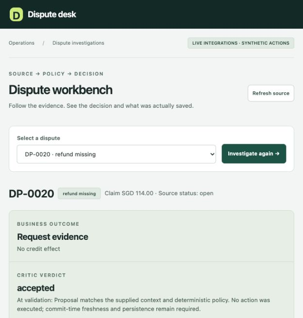
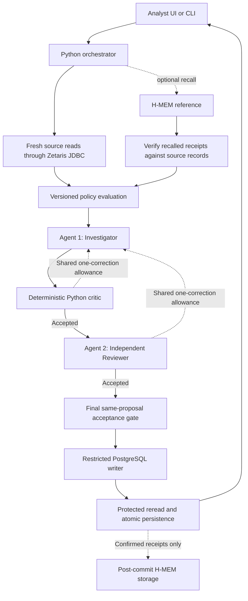

# Synthetic Card-Dispute Resolution Agent

**Open Agent Hackathon 2026 · Track 3: Reasoning Architecture · Team: bob the builder**

A two-agent workbench for investigating fictional card disputes and recording policy-checked, auditable outcomes. An Investigator proposes an action, an independent Reviewer challenges it, and deterministic code controls whether anything can be written to the database.

> All customers, transactions, policies and financial effects are synthetic. This is a local demonstration, not a production banking service.

**[Watch on YouTube — 3:50](https://youtu.be/iZAm5UhTduI)** · **[Download video — MP4, 3:50](./docs/submission/final-presentation/hackathon-presentation.mp4)** · **[Presentation — 10-slide PPTX](./docs/submission/final-presentation/hackathon-presentation.pptx)** · **[Transcript and evidence](./docs/submission/final-presentation/TRANSCRIPT.md)** · **[Submission package](./docs/submission/README.md)**

The video is an edited, narrated presentation using recorded application captures and dated test evidence. Live runs, scripted rehearsals and injected faults are labelled separately. The team confirmed public, signed-out YouTube playback, clear audio, readable slides and approximately 3:50 duration on 27 October 2026. The MP4 download is also retained in the repository.



*Recorded live two-agent acceptance for DP-0020. This run used live Zetaris and Nightshift with memory disabled; it saved an evidence request, not a credit. [Evidence receipt](./dispute-demo/docs/evidence/t16-live-accepted.json).*

**On this page:** [Problem and outcomes](#problem-and-outcomes) · [Architecture](#architecture-and-agent-responsibilities) · [Run the project](#run-the-project) · [Repository structure](#repository-structure) · [Demo cases](#demonstration-cases) · [Tests](#testing-and-recorded-evidence) · [Documentation](#documentation)

## Problem and outcomes

The demonstration asks a practical question: can an agent propose a useful dispute outcome without bypassing evidence requirements, policy or duplicate-payment protection?

For example, DP-0014 has an SGD 100 capture and an SGD 40 completed merchant refund. Its remaining eligible amount is SGD 60, not SGD 100. The application must distinguish that existing refund from a new simulated provisional credit and prevent the credit from being created twice. [Case walkthrough](./docs/submission/DEMO.md).

| Outcome | Meaning in this demonstration |
|---|---|
| `provisional_credit` | Record an eligible simulated credit for the policy-calculated amount. |
| `request_evidence` | Record a request for missing evidence without a credit effect. |
| `decline` | Record a policy-supported decline without a credit effect. |
| `human_review` | Record a policy-required review item without automatically granting credit. |

Eligible outcomes do not require a blanket manual approval step. A technical failure or invalid model response is different from a business outcome: it stops without inventing a persisted decision or review item. The review queue is implemented; manual adjudication is not. See the [workflow guide](./dispute-demo/docs/workflow.md) and [analyst guide](./dispute-demo/docs/analyst-ui.md).

## Architecture and agent responsibilities



**The critic and Reviewer share one correction allowance in total.** They do not each receive a separate retry. Unresolved objections, exhausted budgets or malformed output stop the run without a write. Both checks must accept the same final proposal before the controller proceeds. [Architecture](./docs/submission/ARCHITECTURE.md) · [Reviewer contract](./dispute-demo/docs/reviewer.md).

| Component | Responsibility | Main implementation |
|---|---|---|
| Investigator — AI agent | Propose a structured outcome using supplied evidence and policy results. | [`investigator.py`](./dispute-demo/app/investigator.py) |
| Reviewer — AI agent | Independently challenge the proposal and return structured acceptance or revision feedback. | [`reviewer.py`](./dispute-demo/app/reviewer.py) |
| Orchestrator — Python code | Coordinate reads, both roles, the shared correction allowance, final acceptance and recovery. | [`orchestrator.py`](./dispute-demo/app/orchestrator.py) |
| Policy engine and critic — Python code | Evaluate the synthetic rules and validate amounts, citations and supported rationale. | [`policy_engine.py`](./dispute-demo/app/policy_engine.py), [`critic.py`](./dispute-demo/app/critic.py) |
| Action service — Python/PostgreSQL | Recheck protected source state and commit the decision, optional credit, audit and review entry atomically. | [`action_service.py`](./dispute-demo/app/action_service.py) |
| Verified memory workflow | Validate recalled receipt/customer context and store confirmed summaries; memory-only retries cannot repeat an action. | [`memory_workflow.py`](./dispute-demo/app/memory_workflow.py) |

The Investigator and Reviewer are separate Nightshift calls with different roles and prompts; they may use the same underlying model. The Python critic and orchestrator are not additional AI agents. Neither model has direct SQL or financial-write authority. Reviewer acceptance is enforced by the controller; the writer separately protects source, policy and transaction checks. [Detailed boundaries](./docs/submission/ARCHITECTURE.md).

## Technology and sponsor integrations

| Technology | Implemented use | Important boundary |
|---|---|---|
| Zetaris | [Live JDBC](./dispute-demo/docs/workflow.md) retrieval for the decision workflow; separately, a compiled/activated three-source Unified Semantic Layer and native data-quality checks. | Decision-authorising reads still use the coherent PostgreSQL source. The three-source preview is read-only. |
| Meterless Nightshift | [Primary model transport](./dispute-demo/docs/reviewer.md) for both independently invoked agents. | Malformed live responses fail visibly; there is no silent scripted fallback. |
| Meterless H-MEM | [Pinned official reference](./dispute-demo/docs/memory.md) for persistent storage, recall and source-verified advisory history. | Uses deterministic mock embeddings; advanced dreaming/sleep/conflict workflows are not implemented. |
| NVIDIA model metadata | [Recorded live responses](./dispute-demo/docs/evidence/t16-live-accepted.json) report `nvidia/nemotron-3.5-bolt-e4b` through `meterless/auto`. | This is returned metadata, not independent provider attestation or an award-eligibility claim. |
| Python, PostgreSQL and TypeScript | Controller, policy, critic, atomic actions, local UI and H-MEM bridge. | All financial effects are simulated; there is no real payment-rail connection. |

### Three-source USL inspection

The optional Unified Semantic Layer joins three independently registered connectors: PostgreSQL dispute records, merchant-evidence CSV files through FileStore, and a fixed customer-history REST fixture. All three sources contain synthetic data. Native key-quality execution includes a controlled invalid-reference fixture. [USL guide](./docs/zetaris-usl/README.md) · [Native quality evidence](./docs/zetaris-usl/data-quality.md).

**This preview does not feed the Investigator's decision-authorising snapshot or the action writer.** Its source freshness and cross-source atomicity remain unverified. Showing a joined record does not make it eligible to authorise a payment. [Integration evidence and limitations](./docs/submission/ARCHITECTURE.md).

## Run the project

Choose the route that matches what you need to inspect.

| Route | What it runs | Private service credentials? |
|---|---|---|
| **A. Isolated CLI rehearsal** | Canonical policy, critic, two-agent control flow, real disposable PostgreSQL and the real H-MEM reference, with scripted model responses. | No. Initial dependency downloads require network access. |
| **B. Live analyst UI or CLI** | Live Zetaris reads and Nightshift calls, restricted PostgreSQL actions and optional verified memory. | Yes, plus the licensed Zetaris/JDBC components. |
| **Optional USL preview** | Read-only inspection of the separately provisioned three-source semantic model. | Requires a configured Zetaris stack and the USL sources/model. |

### A. Fresh checkout: isolated rehearsal

Prerequisites: macOS/Linux, Git, Python 3.10+ (recorded tests used 3.13.7), a running Docker engine, and **Node 24.13.0 / npm 11.18.0 selected on PATH**. Windows/WSL has not been verified. These are the repository's documented versions, not a claim that every other version is supported. [Reproduction guide](./docs/submission/DEMO.md).

Run the following in a new checkout. Stop and resolve any failed setup command before continuing.

```sh
git clone https://github.com/rachelanneliew/Open-Agent-Hackathon.git
cd Open-Agent-Hackathon/dispute-demo

python3 -m venv .venv
.venv/bin/python -m pip install -r requirements-runtime.txt

# Confirm the required Node and npm versions before continuing.
node --version
npm --version
export HMEM_NODE="$(command -v node)"

# Fetch the pinned reference and install the locked bridge dependencies.
.venv/bin/python scripts/setup_hmem.py
npm --prefix agent/hmem_bridge ci --ignore-scripts --no-audit --no-fund

# One-time image preparation; the replay does not pull images itself.
docker pull postgres:16-alpine
.venv/bin/python scripts/validate_synthetic_data.py

# Preview the isolation plan; this command does not run the rehearsal.
.venv/bin/python -m demo.replay

# Explicitly create, replay and clean only owned disposable test state.
.venv/bin/python -m demo.replay --reset-isolated-demo
```

The preview reports `status: "preview_only"`. A successful execution reports `status: "passed"` and contains results from two isolated replay cycles. It creates and cleans only its own temporary database/memory resources; it does not reset your shared application database or memory. [Replay implementation](./dispute-demo/demo/replay.py).

**This is a CLI rehearsal, not an offline copy of the interactive UI.** Model responses are scripted and reads use isolated PostgreSQL directly instead of the live Zetaris transport. The H-MEM engine is the real pinned reference with mock embeddings. No live Nightshift or Zetaris request is made.

### B. Full live application

First complete [TEAM_SETUP.md](./TEAM_SETUP.md), the current [workflow deployment instructions](./dispute-demo/docs/workflow.md) and the [live reproduction guide](./docs/submission/DEMO.md). Reuse the Python/H-MEM setup above where applicable; do not recreate or overwrite an already working environment.

The live path additionally requires the licensed Zetaris stack and matching JDBC driver, working source registration/read views, database migrations 001/002, a restricted action login and a running Nightshift runtime with an available model provider.

| Configuration | Location / rule |
|---|---|
| `ZETARIS_JDBC_URL`, `ZETARIS_JDBC_JAR`, `ZETARIS_USERNAME`, `ZETARIS_PASSWORD` | Private `getting-started/.env.local`, following the live setup guide. |
| `DISPUTE_ACTION_DSN`, `METERLESS_RUNTIME_TOKEN` | Private `dispute-demo/.env.local`; see the [sanitised example](./dispute-demo/integration/env.example). Use the restricted action login, not the loader/admin account. |
| Model-provider API key | Configure inside Nightshift; never commit it. |
| `HMEM_NODE` | Export the selected pinned Node executable in the shell used to launch the app. |

**Fresh-clone limitation:** `getting-started/` and `zetaris-platform/` are recorded as Git links without a `.gitmodules` mapping. A clean clone does not populate them. Follow [TEAM_SETUP §1](./TEAM_SETUP.md#1-get-the-project-and-prerequisites) to clone the official `zetaris/getting-started` helpers and obtain your own platform bundle from Zetaris Cloud → Run locally, including the matching provider JDBC driver. If access or the driver is unavailable, contact the organisers/provider. The isolated rehearsal does not need them; a clone alone is not a complete live installation. Do not redistribute licensed components or credentials. [Setup limitation](./docs/submission/DEMO.md).

After live provisioning, run from `dispute-demo/`:

```sh
.venv/bin/python -m app.ui --memory-dir outputs/demo-memory
```

Open `http://127.0.0.1:8931`. Select a case, inspect its evidence, choose **Investigate**, then inspect the outcome, Investigator/Reviewer feedback, critic result and persistence status. Stop the server with Ctrl-C. Keep it loopback-only; it is not a production-authenticated public service.

For a single live investigation instead of the UI:

```sh
# Run from dispute-demo/ after completing live setup.
.venv/bin/python -m app.main DP-0020 --memory-dir outputs/demo-memory
```

A live investigation can persist a simulated decision. Existing sandbox cases may already have outcomes, so a new run is not guaranteed to reproduce an earlier recording. Do not reset shared state or keep retrying to force a desired outcome. An empty memory directory has no previous history. [Case and recovery guidance](./docs/submission/DEMO.md).

### Optional: inspect the USL preview

Provision the separate connectors/model first using the [USL setup guide](./docs/zetaris-usl/README.md). On an already configured stack, from `dispute-demo/`:

```sh
# Read one case through the optional preview adapter.
.venv/bin/python -m integration.usl_reads DP-0020 --enable

# Alternative UI demonstration; memory is explicitly disabled here.
.venv/bin/python -m app.ui --port 8933 --no-memory --usl-preview
```

Open `http://127.0.0.1:8933`, enter DP-0020 as the preview case and choose **Load USL preview**. No investigation is needed. The preview is disabled by default, and its displayed data-quality receipt is dated evidence rather than a newly executed quality test. Do not blindly rerun source registration or model compilation on an existing stack.

## Repository structure

```text
Open-Agent-Hackathon/
├── README.md                      # Project entry point for judges and developers
├── TEAM_SETUP.md                  # Detailed live environment setup
├── AGENTS.md                      # Coding-assistant entry instructions
├── context.md                     # Canonical project scope and boundaries
├── ROADMAP.md                     # Development history and acceptance evidence
├── agent.md                       # Coding-assistant operating guidance
├── CLAUDE.md                      # Claude entry guidance
├── dispute-demo/
│   ├── app/                       # Canonical application implementation
│   │   ├── main.py                # Live CLI entry point
│   │   ├── ui.py                  # Local analyst server
│   │   ├── web/                   # Browser HTML, CSS and JavaScript
│   │   ├── investigator.py        # Agent 1
│   │   ├── reviewer.py            # Agent 2
│   │   ├── orchestrator.py        # Bounded coordination and final acceptance
│   │   ├── policy_engine.py       # Synthetic policy evaluation
│   │   ├── critic.py              # Deterministic proposal validation
│   │   ├── action_service.py      # Protected transactional writes
│   │   └── memory_workflow.py     # Source verification and memory-only recovery
│   ├── agent/                     # H-MEM bridge/client and compatibility modules
│   │   └── tests/                 # Reference/compatibility test root
│   ├── integration/               # JDBC, Nightshift and source adapters
│   │   ├── usl/                   # Semantic-model SQL, fixtures and verification
│   │   ├── usl_sources/           # Fixed REST-fixture service
│   │   └── usl_reads.py            # Optional bounded read-only preview
│   ├── db/                        # Database definitions and migrations
│   ├── policies/                  # Versioned fictional dispute rules
│   ├── data/                      # Committed synthetic datasets
│   ├── scripts/                   # Reference setup and data validation
│   ├── demo/                      # Isolated replay and two-root verification
│   ├── tests/                     # Main application test root and fixtures
│   ├── docs/                      # Technical guides and recorded evidence
│   └── requirements-runtime.txt   # Application Python dependencies
├── docs/
│   ├── competition.md             # Dated requirements audit
│   ├── submission/                # Demo guide, architecture and package index
│   │   └── final-presentation/    # Current MP4, PPTX, transcript and captions
│   └── zetaris-usl/               # Three-source setup and quality evidence
├── getting-started/               # External Git link; separate live setup
└── zetaris-platform/              # External Git link; separate licensed setup
```

This is a selected navigation tree, not an exhaustive file listing. Use `app.main`, `app.ui` and `demo.replay` as the documented entry points; do not use the retired prototype resolver as an alternative live workflow.

## Demonstration cases

Expected policy outcomes and recorded live behaviour are deliberately distinguished. Full source links and additional cases are in the [demo guide](./docs/submission/DEMO.md).

| Case | What it demonstrates | Evidence mode / observed result |
|---|---|---|
| DP-0014 | SGD 100 capture minus SGD 40 merchant refund gives SGD 60 eligible simulated credit; duplicate effects are prevented. | Scripted two-agent rehearsal with real isolated PostgreSQL; an earlier live workflow and exact recovery are separately recorded. |
| DP-0020 | Missing `refund_confirmation`. | Recorded live two-agent run saved `request_evidence` with no credit. Memory was disabled. |
| DP-0008 | Otherwise eligible amount exceeds SGD 200. | Scripted rehearsal and an earlier live UI run recorded policy-required human review, without credit. |
| DP-0003 | Deliberately propose SGD 200.01 where SGD 200 is allowed. | Injected scripted fault; critic rejection, one correction and isolated commit. Not a spontaneous live model mistake. |
| DP-0017 | Recall and verify the earlier DP-0014 customer receipt. | Scripted two-agent rehearsal with the real H-MEM reference; earlier live memory evidence is separately dated. |
| DP-0029 | Filing-window decline and the distinction between policy result and model acceptance. | Scripted rehearsal records a decline. The live Reviewer objected twice around one correction, causing safe refusal and **no write**. |

Exact recovery uses the original saved request; it is not the same as starting another investigation. Memory-only recovery cannot invoke a financial action. Use the [documented recovery commands](./docs/submission/DEMO.md) and retain private journals outside Git.

## Testing and recorded evidence

From `dispute-demo/`, after installing the dependencies for the selected mode:

```sh
# Collect both test roots; unavailable integration checks are explicit skips.
.venv/bin/python -m demo.verify

# Disposable PostgreSQL, real reference memory and local HTTP fixtures.
# Requires the Docker/image and pinned H-MEM setup from Route A.
.venv/bin/python -m demo.verify --integrations
```

The latest recorded USL regression result from 27 October 2026 contains **328 passing application tests + 16 passing reference/compatibility tests, with zero failures, errors or skips**. The 30 USL tests are already included in the 328. This is dated evidence, not a claim that the tests ran during the current documentation edit. [Regression receipt](./docs/zetaris-usl/evidence/regression.json).

`--integrations` runs isolated integration tests, not live Zetaris or Nightshift validation. The earlier T16 total of 298 + 16 remains a historical result. Neither count is a live model-accuracy benchmark. [Verification implementation](./dispute-demo/demo/verify.py).

| Evidence | What it establishes |
|---|---|
| [Live two-agent acceptance](./dispute-demo/docs/evidence/t16-live-accepted.json) | Separate Investigator/Reviewer calls and a persisted DP-0020 evidence request. |
| [Live correction and refusal](./dispute-demo/docs/evidence/t16-live-refusal.json) | A bounded correction loop that ended without a write on DP-0029. |
| [Exact-request recovery](./dispute-demo/docs/evidence/t16-recovery.json) | Reuse of the accepted decision without new model calls. |
| [Isolated replay](./dispute-demo/docs/evidence/t16-isolated-replay.json) | Scripted-model coverage of outcomes, faults, memory and duplicate prevention. |
| [Earlier live memory evidence](./dispute-demo/docs/evidence/t10-verified-memory.json) | Separately dated source-verified memory behaviour, not a claim that memory ran in the live T16 acceptance. |
| [USL acceptance evidence](./docs/zetaris-usl/demo-evidence.md) | Three-source semantic-model and native data-quality demonstrations. |

## Safety, limitations and troubleshooting

The safety design keeps policy, money arithmetic, source checks and persistence outside the language models. Exact saved-request recovery and database constraints prevent duplicate effects; source-verified memory is advisory and cannot override policy. Technical failures do not silently become approvals or human-review records. [Action boundaries](./dispute-demo/docs/actions.md).

Current limits include synthetic document templates and canonical rationale, possible conservative Reviewer refusals, mock memory embeddings, no advanced memory lifecycle, no production authentication and no real financial integration. The USL preview is not a cross-source transactional snapshot. Business time savings and model accuracy improvements have not been measured. [Full limitations](./docs/submission/ARCHITECTURE.md).

| Symptom | What to check |
|---|---|
| `.venv/bin/python` is missing | Confirm you are in `dispute-demo/` and complete the virtual-environment setup. |
| Replay or reference tests fail during setup | Check Docker, the pre-pulled PostgreSQL image, pinned Node/npm, `HMEM_NODE`, reference setup and bridge dependencies. |
| The default test command reports skipped checks | This is expected for opt-in integration checks. Prepare Route A and use `--integrations` for isolated integration coverage. |
| Live source/model access fails | Check the private service setup; do not substitute scripted results and call them live. |
| A case already has a credit | Do not reset shared state. Inspect the existing result and use the original saved request for exact recovery where appropriate. |
| External Git-link folders are empty | Complete authorised live setup separately; the isolated replay does not require those folders. |

## Documentation

| Start here | Purpose |
|---|---|
| [Demo and reproduction guide](./docs/submission/DEMO.md) | Setup, case details, evidence modes and recovery. |
| [Architecture](./docs/submission/ARCHITECTURE.md) | Component responsibilities, sponsor evidence, provenance and limits. |
| [Live team setup](./TEAM_SETUP.md) | Zetaris/JDBC, PostgreSQL, Nightshift and memory provisioning. |
| [USL guide](./docs/zetaris-usl/README.md) | Separate three-source setup, native quality checks and preview. |
| [Workflow](./dispute-demo/docs/workflow.md) and [reliability](./dispute-demo/docs/reliability.md) | Runtime boundaries, verification and isolated reset behaviour. |
| [Submission package](./docs/submission/README.md) | Current deliverables and remaining owner-only submission checks. |

<details>
<summary>Maintainer and coding-assistant documents</summary>

Read [AGENTS.md](./AGENTS.md) before development. [context.md](./context.md) defines project scope; [ROADMAP.md](./ROADMAP.md) records tasks and acceptance evidence. [agent.md](./agent.md) and [CLAUDE.md](./CLAUDE.md) provide additional operating guidance. The [competition audit](./docs/competition.md) is a dated requirements record, not a submission receipt.

</details>

### Acknowledgements and submission status

Built by **bob the builder** using existing Zetaris components, Meterless Nightshift and the H-MEM reference, PostgreSQL and the listed Python/Node dependencies. Codex, Claude Code and Cursor are development tools, not runtime agents. See the [provenance declaration](./docs/submission/ARCHITECTURE.md) for external work and owner declarations. Public source access does not by itself grant an application license; no license is added by this README.

The current presentation includes the two-agent workflow and the USL/data-quality extension. Superseded media editions are recoverable from Git history, not presented as current checkout assets. Repository publication is not proof of HackOS submission; the team has confirmed video access, roster, contributor permission and no earlier team project code/data during submission preparation. The [submission package](./docs/submission/README.md) retains the dated audit and leader-only form checks; final HackOS confirmation remains unverified.
