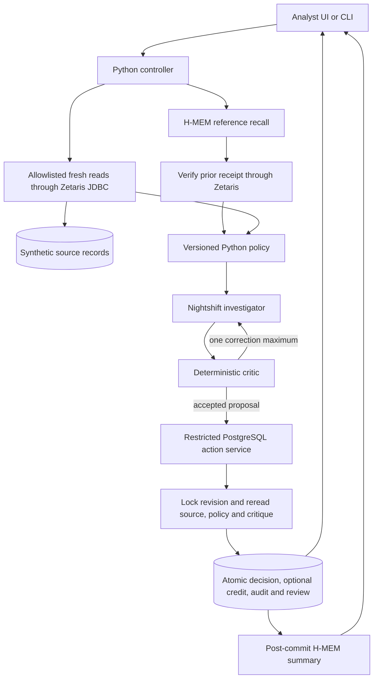

# Architecture and technology evidence

One model investigator proposes a structured outcome. Deterministic code owns
policy, validation, bounded execution and persistence. All records and effects
are synthetic.

The investigator never executes SQL or writes to the database. The controller
allows four model requests, three reads and 300 seconds by default, with at most
one critic correction. A failed model or required source read cannot create a
credit or fictitious review item. Rationale currently must match canonical
policy explanations. The deterministic critic is not a second language model.

The writer uses an unprivileged login and a global revision guard enforced for
source and action writers. It compares fresh facts, reevaluates policy and
critique, then commits decision/effect/audit/queue together. An identical saved
request reuses its result. New keys cannot bypass one-credit constraints.
Merchant refunds are source facts, separate from simulated provisional credits.

Memory persists only confirmed receipts. Recall candidates need customer,
source-ID, cutoff, revision and receipt checks. Recall is partial advisory
context and cannot alter the written policy. A memory failure preserves the
confirmed decision. Retrying memory cannot invoke an action.

## Actual contributions

| Technology | Working use and evidence | Limit |
|---|---|---|
| Zetaris | JDBC retrieval of source facts, current policy, revision-bounded bundle and prior receipts. [T08](../../dispute-demo/docs/evidence/t08-live-workflow.json), [T10](../../dispute-demo/docs/evidence/t10-verified-memory.json). | One PostgreSQL datasource. No three-source federation or USL. REST is unconfigured. |
| Meterless Nightshift | Primary live model transport for strict proposals and one correction. [T07](../../dispute-demo/docs/evidence/t07-live-DP-0014.json) and T08/T10/T11. | Malformed output can fail validation. No deterministic replacement in normal runtime. |
| NVIDIA | Requested `meterless/auto`, observed response model `nvidia/nemotron-3.5-bolt-e4b` in actual model metadata. | Returned label is not independent provider attestation. No claim of award eligibility from model discovery alone. |
| Meterless H-MEM | Official reference pinned at `1742dec56a66e58eef9dda2d2b865823758ca8cd`, actual persistent storage/retrieval and source verification. [T09](../../dispute-demo/docs/evidence/t09-reference-memory.json), T10, T12. | Deterministic mock embeddings. Dreaming/sleep/conflict workflows are not implemented. No formal approval of exact revision found. |
| PostgreSQL | Protected rereads, atomic all-outcome decisions, concurrency constraints and durable recovery. [T12 matrix](../../dispute-demo/docs/reliability.md). | Trusted administrator remains a privileged boundary. No actual banking integration. |
| Python and TypeScript | Controller/policy/critic/UI and memory bridge. Buildless HTML/CSS/JavaScript analyst page. | Local single-host reference demo, not production authentication or deployment. |

Codex, Claude Code and Cursor are development tools, not runtime agents. Current
official rules make Cursor optional. The product contribution is the complete
source-to-proposal-to-critic-to-transaction workflow, durable retry boundary and
independent source-verified memory. No measured business time saving is claimed.

## Provenance declaration for owner review

Reachable project Git history begins on **24 October 2026**, after the rules'
22 October 00:00 UTC threshold. This establishes commit dates, not proof that
all underlying work was first authored then. The team must confirm any earlier
untracked product code or data before submitting its declaration.

Existing external work includes Zetaris's platform/driver and onboarding
helpers, Nightshift, the official Meterless reference, Python/Node dependencies
and PostgreSQL. Their names, source pin and dependency manifests are disclosed;
we do not claim authorship of those implementations. PR #4 supplied the team's
initial prototypes on 26 October. T01–T12 integrate/harden those into the
canonical workflow. The generated dataset and policies are fictional project
assets, with reproducibility evidence in the repository.

The licensed platform/JDBC bundle is obtained from the provider and is not
redistributed in this package. The repository's two Git links need separate
live setup. No standalone application license was found, so public source
access should not be read as a new license grant. The submission owner must
confirm contributor permission and any earlier-work declaration.

## Delivery limitations

The [authenticated audit](../competition.md) records leader-only submission
access, detailed Track 3 page access, two-agent interpretation and exact-reference
endorsement limits. New Zetaris scoring guidance asks for three datasources and
USL demonstrations. The present one-datasource workflow does not satisfy that
scoring example. Future work can add richer evidence interpretation, production
controls, memory lifecycle features and separately scoped USL federation.
